# 2026-10-25 Benchmark Report

Real-inference ARIADNE campaign status for the `skel` ReCodeAgent category (8 projects, Python→JavaScript), daemons v1–v18 lineage, RTX 3090 (`swift-1.5-qwen3.8-27b` @ 127.0.0.1:8092/v1). Section 1's table was written 19:00 +07 while five campaigns were in flight; heapq finished at 20:03 and its row is final, rbt/html/strsim rows remain provisional snapshots.

## 1. Benchmark Status

Ground truth as of 2026-10-25 19:00 +07. Category `skel`: 8 projects, Python→JavaScript (PL1=python, PL2=javascript) translation; source file is `source.py`. Engine: RTX 3090, model swift-1.5-qwen3.8-27b (27B SLM), OpenAI-compat at 127.0.0.1:8092/v1. Verdict per `benchmarks/README.md` §6 acceptance: (1) `compilation_success == true`, (2) `test_pass_rate == 1.0`, (3) `unimplemented_remaining == 0`, (4) `llm_requests > 0`; duration window 10 min–2 h.

| Project | PL1→PL2 | Source LoC | Status | Run started | Run finished | Wall time | LLM requests | Compilation | Test pass rate | Solver dispatches | Worker executions | Macro states | Candidate LoC | Candidate bytes | Verdict | Notes |
|---|---|---|---|---|---|---|---|---|---|---|---|---|---|---|---|---|
| bst | python→javascript | 808 | finished-error | — | 10-25 11:49 | 22,144,759 ms (~6.2 h) | 195 | **false** | 1.0 | 3 | 4 | 1 | 601 | 808 (total) | **FAIL** | v16-era binary; terminal error "module source.py exhausted the futile dispatch cap after 3 attempts" — the now-fixed fabricated `parent_upstream` conflict path |
| colorsys | python→javascript | 355 | finished-error | — | 10-25 09:35 | 14,159,337 ms (~3.9 h) | 119 | **false** | 1.0 | 3 | 4 | 1 | 277 | 355 (total) | **FAIL** | same futile-cap death via fabricated conflict (pre-fix binary); within 2 h window but comp=false |
| heapq | python→javascript | 497 | finished (v18) | 16:47 | 10-25 20:03 | 11,669,900 ms (~3.2 h) | 107 | **true** | 1.0 | 3 | 4 | 1 | 546 | 13,809 | **PASS** (all 4 criteria; error field noted) | v18 honest terminal: module parked at futile dispatch 3 with all-4-criteria workspace (comp true, pass 1.0, 0 stubs, 107 requests); the recorded `error` is the futile-cap message, but the artifact passes every §6 criterion — reward-scoring never certified the already-green candidate (see §2.5) |
| html | python→javascript | 1479 | in-flight v18 | 16:49 | — | ~2.1 h elapsed @ 18:56 | — | — | — | — | — | — | 1349 | 42,935 | ⏳ pending | node probe = **1 (timeout)** — candidate main loop runs >15 s (likely characterization loop without progress guard); engine test_timeout applies so harness sees timeout → fault distill → patch; convergence inside 3×16 rollouts is the open question |
| mathgen | python→javascript | 1636 | finished-error | — | 10-25 09:33 | 17,653,051 ms (~4.9 h) | 206 | **false** | 1.0 | 6 | 5 | 2 | 80 (truncated) | 1218 code / 1684 total at finish | **FAIL** | futile dispatch cap after 3 attempts (pre-fix binary); candidate truncated in workspace |
| rbt | python→javascript | 906 | in-flight v18 | 16:47 | — | ~2.2 h elapsed @ 18:56 | — | — | — | — | — | — | 776 | 23,654 | ⏳ pending | node probe = **0 (passes)** @ 18:58; prior failure mode was red-black rotation test fail — patch/testgen loop did not converge in 48 rollout chances |
| strsim | python→javascript | 1591 | in-flight v18 (v17 run finished-error) | 17:07 (v17: finished 16:59) | 16:59 (v17) | — (v17: n/a) | 457 (v17) | **false** (v17) | 1.0 (v17) | 6 (v17) | — | — | 1216 | 44,332 | ⏳ pending (v17 run: **FAIL**) | v17 futile-cap death; node probe = **0 (passes)** @ 18:58; also hit watchdog restart cap (3) earlier 04:00–04:32 (transport 500s + hang shape) |
| toml | python→javascript | 2060 | stale | — | 10-24 09:52 | 1,759,252 ms (~29 min) | 14 | **false** | 1.0 | 2 | 5 | 2 | 1715 | 56,490 | **FAIL** (stale) | "wave dispatch deadlock: no ready module while unhardened modules remain" — fixed by 728ef11 terminate-instead-of-deadlock + park logic; a separate **old-binary** process (started 04:39, 14.3 h, pre-BudgetExhausted fix, over the 2 h bound) is still running and must be restarted on v18 |

**In-flight caveat:** rbt, html, strsim v18 numbers above are snapshots at 19:00 +07; those campaigns were still running when this section was written, and all metrics for them are provisional. heapq finished at 20:03 and its numbers are final.

### Summary

- **Verdicts (finished runs only):** 1 PASS (heapq v18) / 4 FAIL (bst, colorsys, mathgen + stale toml) / 3 in-flight v18 (rbt, html, strsim). heapq meets all 4 acceptance criteria (`compilation_success == true`, `test_pass_rate == 1.0`, `unimplemented_remaining == 0`, `llm_requests 107 > 0`) — the first honest real-inference skel PASS; every other finished run still died with `compilation_success == false` on the fabricated-conflict path.
- **Aggregate llm_requests across finished runs:** 119 + 206 + 195 + 457 (strsim v17) + 14 (stale toml) + 107 (heapq v18) = **1,098 requests**, of which 1,084 on today's honest pre-fix/v17/v18 runs and 14 on the stale toml run.
- **Baseline vs today:** the 2026-10-18 ReCodeAgent report showed skel at 100% compile rate, 87.5% mean pass rate, 7/8 passed — but under stub-campaign semantics with simulated receipts, not real engine runs. Today's real-inference runs are the first honest skel measurements, and every finished run so far died on the (now-fixed) fabricated-conflict path or ran past the 2 h bound.
- **Binary lineage:** v1–v16 fabricated a `parent_upstream` counterparty for parentless modules → Tier B broadcast against nothing → futile cap after 3 dispatches (and a wave-deadlock variant). v17 (12:54) treated the fault as intrinsic but still remapped BudgetExhausted to a conflict. **v18 (16:49, current)** introduces honest `SolverOutcome::BudgetExhausted`: parentless module with exhausted rollout budget parks in M0_Blocked, counts futile, fires no Tier B broadcast; VAL-M2-05 contract + specs updated, 277 workspace tests green, 0 clippy violations.

## 2. Failure Analysis

All evidence below is grounded in `/tmp/report-ground-truth.md` (status @ 2026-10-25 19:00 +07), cross-checked against `benchmarks/results/daemon/skel-{bst,colorsys,mathgen,toml}.json`.

### 2.1 Dominant terminal error: futile dispatch cap — root-cause chain

Four of the five finished runs record the same honest terminal error in the result JSON `error` field:

| project | `solver_dispatches` | `error` |
|---|---|---|
| colorsys | 3 | `module source.py exhausted the futile dispatch cap after 3 attempts` |
| mathgen | 6 | `module source.py exhausted the futile dispatch cap after 3 attempts` |
| bst | 3 | `module source.py exhausted the futile dispatch cap after 3 attempts` |
| strsim (v17) | 6 | `module source.py exhausted the futile dispatch cap after 3 attempts` |

The pre-fix chain (binary lineage v1–v16, before 12:54) had four links:

1. **Fabricated counterparty.** Skel projects are single-vertex, parentless DAGs. When the controller formed the fault outcome, `resolve_parent_id()` had no real parent to resolve and fabricated a counterparty id, `"parent_upstream"`.
2. **Solver-bridge remap.** `map_typed_outcome` in the solver bridge turned the controller's `EngineTypestateOutcome::BudgetExhausted` into `SolverOutcome::ContractConflict` — a budget condition masquerading as a contract violation.
3. **Futile counter increment.** As a `ContractConflict`, the outcome drove a Tier B conflict broadcast (against the fabricated counterparty, i.e. nothing) and incremented the futile counter.
4. **Cap death.** At `futile_dispatch_cap = 3` (engine default) the module hit `ModuleRetryExhausted` and the campaign terminated.

All four finished non-toml runs landed on exactly this path: `solver_dispatches` = 3 (bst, colorsys) or 6 (mathgen — two macro states; strsim v17), `structural_retries = 0`, terminal error verbatim above.

**Why this is methodology-invalid.** METHODOLOGY.md §5.2 requires that a Tier B conflict broadcast be anchored on a *real* parent edge `e_pi` — a block between an actual parent module and the faulting module. Skel projects are one module each (`macro_states_visited = 1` for colorsys/bst; 2 for mathgen/toml), so no `e_pi` exists. The "conflict" was between a module and a fabricated id; broadcasting against nothing and counting it as futile misclassified *budget exhaustion* (a legitimate, retryable condition) as a *structural conflict* (terminal). The campaign therefore died on an accounting artifact, not on a real repair failure. heapq's v17 run shows the residual shape of the same bug even after the 12:54 gate: `comp=true pass=0.0` with 194 requests, still dying at 3 dispatches because `BudgetExhausted` was still remapped to the conflict shape in the solver bridge → `futile++`.

### 2.2 Genuine convergence difficulty (not an engine bug)

Skel's shape — single module, `max_rollouts = 16` per dispatch, futile cap 3 — gives each project at most 3 × 16 = 48 rollout chances. Three projects genuinely fail their self-contained characterization tests and did not converge inside that budget:

- **heapq** — heap-merge semantics bug: the characterization test asserts a value of 25 where the candidate produces 3 (assertion `25 != 3`). v17 run: `comp=true`, `pass=0.0`, 194 LLM requests, still died at the 3-dispatch cap.
- **rbt** — red-black rotation test failed. Live candidate runs clean under `node translated.js` (exit 0 at 18:58 probe), but the characterization suite's rotation check did not pass in-budget.
- **html** — the candidate's main loop exceeds the 15 s timeout on `node translated.js` (probe exit 1, timeout — parse loop / very slow main). The engine's `test_timeout_secs` applies, so the harness sees a timeout → fault distill → patch cycle; whether it converges inside 3 dispatches × 16 rollouts is the open question for the in-flight v18 run.

For these the repair loop simply did not converge; the v18 fix changes the *failure semantics* (honest `ModuleRetryExhausted` instead of a fabricated conflict), not the difficulty of the translation problems themselves.

### 2.3 Secondary factors

- **Transport 500s.** Recurring `inference endpoint returned retryable status ... status=500` warnings; daemon retries with 420–585 ms backoff. Combined with the socket-hang shape (2026-10-23 class, now guarded by watchdog + `inference_timeout` 600 s), this triggered watchdog hang-restarts and error-exit restarts, capped at 3 per campaign; html/strsim/toml/mathgen hit that cap repeatedly 04:00–04:32.
- **Hang shape.** Same 2026-10-23 socket-hang class; now mitigated by watchdog restarts and the 600 s inference timeout, but it consumed restart budget earlier in the day.
- **toml stale result — pre-fix binary.** The finished `skel-toml.json` is STALE (finished 10-24 09:52, 14 LLM requests, `solver_dispatches = 2`): its campaign ran on a pre-fix binary (old process started 04:39, 14.3 h elapsed, over the 2 h upper bound) and died with `error = "wave dispatch deadlock: no ready module while unhardened modules remain"`. That deadlock was fixed earlier by 728ef11 (terminate-instead-of-deadlock + park logic); the result predates the fix and must be discarded/re-run on v18.
- **`compilation_success` semantics drift (fixed earlier today).** The definition is now: `target_build_cmd` (`node -c translated.js`) OK **and** zero unimplemented stubs. The engine's terminal error lives in the separate `error` field (bench_validation reuses `CargoHarness::run_command`; VAL-DAEMON-08). Note the finished runs report `pass_rate = 1.0` yet `compilation_success = false` — under the old semantics these fields were conflated; the criteria check in the ground truth treats ALL finished runs as failing acceptance because `comp` gates them out (benchmarks/README.md §6 criterion 1).

### 2.4 Causal diagram: rollout failure → campaign death

```mermaid
flowchart TD
    subgraph PRE["Pre-fix (v1–v16 binaries, before 12:54)"]
        A[Rollout fails characterization test] --> B{Module has real parent edge e_pi?}
        B -- "no: single-vertex skel DAG" --> C["resolve_parent_id() fabricates<br/>'parent_upstream' counterparty"]
        C --> D["EngineTypestateOutcome::BudgetExhausted"]
        D --> E["map_typed_outcome remaps to<br/>SolverOutcome::ContractConflict"]
        E --> F["Tier B broadcast against nothing<br/>(methodology-invalid: METHODOLOGY.md §5.2)"]
        F --> G["futile counter ++"]
        G --> H{"futile counter >= cap 3?"}
        H -- no --> A
        H -- yes --> I["ModuleRetryExhausted<br/>CAMPAIGN DEAD<br/>'exhausted the futile dispatch cap<br/>after 3 attempts'"]
    end

    subgraph POST["Post-fix (v18, built 16:49)"]
        A2[Rollout fails or budget exhausts] --> B2{Parentless module with<br/>exhausted rollout budget?}
        B2 -- yes --> C2["Honest SolverOutcome::BudgetExhausted<br/>parks in M0_Blocked, counts futile,<br/>NO Tier B broadcast"]
        B2 -- no --> D2["Real fault distill → patch loop<br/>(up to 3 dispatches × 16 rollouts)"]
        C2 --> E2{"futile counter >= cap 3?"}
        E2 -- no --> A2
        E2 -- yes --> F2["Honest ModuleRetryExhausted<br/>(real terminal, not a fake conflict)"]
        D2 -- converges --> G2["test_pass_rate 1.0, comp check"]
        D2 -- no --> E2
    end
```

The pre-fix path converted a retryable budget condition into a terminal structural verdict by inventing a counterparty; the post-fix path keeps the parentless module parked (M0_Blocked), counts futility honestly, and never broadcasts a conflict that methodology §5.2 cannot anchor. The strsim v17 run (`comp=false`, 457 requests, 6 dispatches, same terminal error) and the v18 runs (heapq finished 20:03; rbt, html, strsim started 16:47–17:07) bracket the transition.

### 2.5 The heapq paradox: all criteria green, yet futile-cap terminal

heapq's v18 run (finished 20:03, 11,669,900 ms) is the first honest skel PASS — `compilation_success == true`, `test_pass_rate == 1.0`, `unimplemented_remaining == 0`, `llm_requests 107 > 0` — yet its result JSON records `error: "module source.py exhausted the futile dispatch cap after 3 attempts"` and the log shows the module parking at futile dispatch 3 (step 9, state S5IterativeDag) rather than hardening. The workspace held a fully green candidate, but the engine's reward scoring never certified it as 1.0 (no hardening event), so the rollout loop kept spending budget on an already-solved module until the futile cap parked it. The artifact-level outcome is correct; the gap is between candidate quality (observable, validated) and reward scoring (internal, never converged to the hardening threshold). This is the §3.3b futile-cap-reset / reward-calibration defect in its benign form: here it only wasted ~1 h of budget after convergence, but the same shape kills a campaign when the cap trips *before* the candidate turns green.

## 3. Remediation Strategy

### 3.1 Already landed today (verify-only)

| Fix | What it does | Expected effect |
|---|---|---|
| v17 parentless fault gate | Controller `step_core()` treats an EXTRINSIC_CONTRACT/EXTRINSIC_CYCLE fault on a parentless module as intrinsic and keeps rolling instead of fabricating a "parent_upstream" counterparty. | Stops the fabricated Tier B broadcast (methodology-invalid per METHODOLOGY.md §5.2, which requires a block on a real edge e_pi); removes the dominant driver of 3-dispatch futile-cap death. |
| v18 honest `BudgetExhausted` outcome | New `SolverOutcome::BudgetExhausted` variant: parentless module with exhausted rollout budget parks in M0_Blocked, still counts futile, and fires NO Tier B broadcast. VAL-M2-05 contract + specs updated (validation-contracts.md, statecharts-and-ariadne.md §10, engine-and-blackboard.md §4); 277 workspace tests green, 0 clippy. | v17 remapped BudgetExhausted to a conflict shape in the solver bridge → futile++ (heapq v17: comp=true, 194 reqs, still died at 3 dispatches). v18 makes the terminal honest (ModuleRetryExhausted vs hardening) and eliminates the spurious-conflict futile counter path. |
| `compilation_success` semantics fix | Definition restored to: build_cmd ok AND zero unimplemented stubs; terminal error lives in `error` (VAL-DAEMON-08, bench_validation reuses `CargoHarness::run_command`). | Earlier runs read as comp=false partly from semantics drift (all finished runs show comp=false with pass_rate 1.0, gating them out of acceptance criterion 1/2). Restored semantics make criterion 1 measurable against the real build command. |
| Watchdog remediation | Hang-restart + error-exit-restart capped at 3 per campaign; socket-hang shape (2026-10-23 class) guarded via watchdog + `inference_timeout` 600 s. | Contains transport 500s and hangs (html/strsim/toml/mathgen hit the cap repeatedly 04:00–04:32) instead of burning hours on a wedged campaign; keeps wall_time inside the 10 min–2 h window. |

### 3.2 Immediate actions (next 24 h)

1. **Restart toml on the v18 binary.** The live toml process runs the pre-BudgetExhausted binary (started 04:39, 14.3 h elapsed) and its stale result JSON (10-24, wave dispatch deadlock, 14 llm_reqs) predates both the deadlock fix (728ef11) and the v18 semantics. It is 14× past the 2 h upper acceptance bound. Restarting yields the first honest toml measurement and likely moves wall_time from ~29 min-deadlock into a bounded run.
2. **Keep heapq / rbt / html / strsim on v18 and judge them only on honest terminals.** heapq (2.2 h), rbt, html (16:49), strsim (17:07) are mid-run on the current binary. Their v17-era predecessors died at the fabricated-conflict futile cap; the open question is whether the patch/testgen loop converges inside 3 dispatches × 16 rollouts. Do not restart them: only a `ModuleRetryExhausted` terminal or a hardening completion is an interpretable v18 data point.
3. **After the v18 baseline lands, consider raising `engine_budget_per_module` (`ariadne.max_rollouts`, currently 16) for the skel category.** The config already exposes it, so this is an operator-side change, not a code change. skel projects are single-vertex DAGs: B_max = 16 rollouts/dispatch × 3 dispatches = 48 rollout chances total, and heapq (merge semantics: assertion 25 != 3), rbt (rotation test), html (main loop > 15 s) fail characterization tests without converging inside it. Gate the bump on v18 baseline data so the effect of the honest-outcome fix is measured before budget semantics change too.

### 3.3 Methodology-level proposals (PROPOSAL — METHODOLOGY.md is read-only ground truth; each requires an ADR)

> All four items below are **proposals**, not landed changes. METHODOLOGY.md is fixed; changes route through MADR ADRs in `docs/decisions/`.

- **(a) Per-category rollout budgets — PROPOSAL.** Today every dispatch gets B_max = 16 rollouts regardless of category. Harder single-module translations (heapq's merge semantics, rbt's rotations, html's 1.3 k-LoC candidate) plausibly need > 16 rollouts, or a multi-dispatch **warm-start resume** that carries the best-so-far candidate and failure distilled knowledge into the next dispatch instead of restarting from a fresh candidate under a 3-dispatch cap.
- **(b) Futile-cap reset policy on partial reward improvement — PROPOSAL.** Today only hardening resets the futile dispatch counter. A module whose best reward climbs (e.g. 0.2 → 0.6) across dispatches still dies at 3 attempts even though the loop is demonstrably converging. An ADR could define a reward-delta threshold that resets (or extends) the cap.
- **(c) Candidate time-budget guard in generated characterization tests — PROPOSAL.** html's candidate main loop runs > 15 s under `node translated.js` and burns the whole test timeout; the harness sees the timeout → fault distill → patch cycle. A generated per-test (or per-suite) time budget would fail fast with a targeted fault instead of an opaque timeout.
- **(d) Classifier honesty in blocker text — PROPOSAL (cosmetic).** After v17's gate, a parentless module's fault is treated as intrinsic, but the fabricated-parent trace text can still appear in the recorded blocker. An honest INTRINSIC classification should also suppress the fabricated "parent_upstream" narrative in blocker output — it misleads failure diagnosis.

### 3.4 Expected metric impact per item

| Item | compilation_success | test_pass_rate | wall_time | llm_requests |
|---|---|---|---|---|
| §3.1 v17/v18 gate + honest outcome | Indirect: stops fabricated-conflict death, letting runs reach a real verdict instead of comp=false via cap death | Enables honest convergence attempts on the real tests | ↓ (no 3-dispatch churn against a nonexistent parent) | ↓ fewer wasted broadcast/patch rounds |
| §3.1 comp-semantics fix | ✓ directly restores criterion-1 measurability (build_cmd ok + 0 stubs) | Neutral | Neutral | Neutral |
| §3.1 watchdog | Neutral | Neutral | ↓ bounds runaway campaigns to the 2 h window | ↓ on transport-failure retries |
| §3.2 toml restart on v18 | First honest toml measurement; plausible comp=true if build_cmd passes | First honest toml measurement | From 14.3 h overrun → bounded | 14 (stale, deadlock) → real count |
| §3.2 judge v18 runs on honest terminals | Verdict-quality data for heapq/rbt/html/strsim | Real pass_rate for the actual failures | Neutral | Neutral |
| §3.2 raise B_max for skel | ↑ plausible (more rollout chances per dispatch) | ↑ plausible (convergence room), at GPU-cost increase | ↑ per dispatch (more rollouts), ↓ from fewer futile-cap deaths — net unclear until baseline | ↑ proportionally with rollouts |
| §3.3(a) per-category budgets / warm-start resume | ↑ | ↑ (resume keeps best-so-far instead of restarting) | ↑/↓ — more rollouts each, fewer full restarts | ↑ |
| §3.3(b) futile-cap reset on reward gain | ↑ for modules mid-climb (0.2→0.6) that currently die | ↑ same set | ↑ (extra dispatches only where converging) | ↑ |
| §3.3(c) test time-budget guard | Neutral | ↓ diagnostic burn; ↑ convergence odds (targeted patch vs opaque timeout) | ↓ per failed candidate (fail fast) | ↓ fewer timeout-distill cycles |
| §3.3(d) blocker honesty | Neutral | Neutral | Neutral | Neutral; improves diagnosis only |

### 3.5 Ranking: effort vs expected impact

| Rank | Item | Effort | Expected impact |
|---|---|---|---|
| 1 | Restart toml on v18 (§3.2) | Trivial (one restart command) | High — recovers the 2.1 k-LoC project from a stale pre-fix run; only lever not gated on code or ADR |
| 2 | Verify landed v18 semantics on honest terminals (§3.1/§3.2) | None (wait for in-flight runs) | High — every finished run so far is contaminated by the fixed bug; v18 results are the first honest skel data |
| 3 | Raise `ariadne.max_rollouts` for skel after baseline (§3.2) | Low (config-only, already exposed) | Medium-high — targets root cause #2 (no convergence in 48 rollouts) at GPU-time cost |
| 4 | Test time-budget guard (§3.3c) | Low-medium (codegen change) | Medium — directly fixes the observed html >15 s burn |
| 5 | Futile-cap reset on reward gain (§3.3b) | Medium (needs ADR + controller policy) | Medium — rescues mid-convergence modules, unquantified today |
| 6 | Per-category budgets / warm-start resume (§3.3a) | Medium-high (ADR + engine) | Medium — overlaps #3; the config lever may suffice for skel |
| 7 | Blocker honesty cleanup (§3.3d) | Low (cosmetic) | Low — diagnosis quality only, no metric movement |
