# 3 · Failure Analysis

Failure taxonomy with root-cause chains. Evidence grounded in `/tmp/report-ground-truth.md`
(status @ 2026-10-25 19:00 +07) and the surviving result JSONs
(`benchmarks/results/daemon/skel-*.json`).

## 3.1 F1 — Dominant terminal error: futile dispatch cap (root-cause chain)

Four of the five measured FAIL runs record the same terminal error in the result JSON `error`
field:

| Project | Binary stratum | `solver_dispatches` | `error` |
|---|---|---|---|
| colorsys | pre-fix | 3 | `module source.py exhausted the futile dispatch cap after 3 attempts` |
| mathgen | pre-fix | 6 | `module source.py exhausted the futile dispatch cap after 3 attempts` |
| bst | pre-fix (v16-era) | 3 | `module source.py exhausted the futile dispatch cap after 3 attempts` |
| strsim | v17 | 6 | `module source.py exhausted the futile dispatch cap after 3 attempts` |

The pre-fix chain (binary lineage v1–v16, before 12:54) had four links:

1. **Fabricated counterparty.** Skel projects are single-vertex, parentless DAGs. When the
   controller formed the fault outcome, `resolve_parent_id()` had no real parent to resolve and
   fabricated a counterparty id, `"parent_upstream"`.
2. **Solver-bridge remap.** `map_typed_outcome` in the solver bridge turned the controller's
   `EngineTypestateOutcome::BudgetExhausted` into `SolverOutcome::ContractConflict` — a budget
   condition masquerading as a contract violation.
3. **Futile counter increment.** As a `ContractConflict`, the outcome drove a Tier B conflict
   broadcast (against the fabricated counterparty, i.e. nothing) and incremented the futile
   counter.
4. **Cap death.** At `futile_dispatch_cap = 3` (engine default) the module hit
   `ModuleRetryExhausted` and the campaign terminated.

All four pre-v18 non-toml measured runs landed on exactly this path: `solver_dispatches` = 3
(bst, colorsys) or 6 (mathgen — two macro states; strsim v17), `structural_retries = 0`,
terminal error verbatim above.

**Why this is methodology-invalid.** METHODOLOGY.md §5.2 requires that a Tier B conflict
broadcast be anchored on a *real* parent edge `e_pi` — a block between an actual parent module
and the faulting module. Skel projects are one module each (`macro_states_visited = 1` for
colorsys/bst; 2 for mathgen/toml), so no `e_pi` exists. The "conflict" was between a module and
a fabricated id; broadcasting against nothing and counting it as futile misclassified *budget
exhaustion* (a legitimate, retryable condition) as a *structural conflict* (terminal). The
campaign therefore died on an accounting artifact, not on a real repair failure. heapq's v17
run shows the residual shape of the same bug even after the 12:54 gate: `comp=true pass=0.0`
with 194 requests, still dying at 3 dispatches because `BudgetExhausted` was still remapped to
the conflict shape in the solver bridge → `futile++`.

## 3.2 F2 — Genuine convergence difficulty (not an engine bug)

Skel's shape — single module, `max_rollouts = 16` per dispatch, futile cap 3 — gives each
project at most 3 × 16 = 48 rollout chances. Three projects genuinely fail their
self-contained characterization tests and did not converge inside that budget:

- **heapq** — heap-merge semantics bug: the characterization test asserts a value of 25 where
  the candidate produces 3 (assertion `25 != 3`). v17 run: `comp=true`, `pass=0.0`, 194 LLM
  requests, still died at the 3-dispatch cap.
- **rbt** — red-black rotation test failed. Live candidate runs clean under
  `node translated.js` (exit 0 at 18:58 probe), but the characterization suite's rotation check
  did not pass in-budget.
- **html** — the candidate's main loop exceeds the 15 s timeout on `node translated.js`
  (probe exit 1, timeout — parse loop / very slow main). The engine's `test_timeout_secs`
  applies, so the harness sees a timeout → fault distill → patch cycle; whether it converges
  inside 3 dispatches × 16 rollouts is the open question for the (now killed) v18 run.

For these the repair loop simply did not converge; the v18 fix changes the *failure semantics*
(honest `ModuleRetryExhausted` instead of a fabricated conflict), not the difficulty of the
translation problems themselves.

## 3.3 F3 — Secondary factors

- **Transport 500s.** Recurring `inference endpoint returned retryable status ... status=500`
  warnings; daemon retries with 420–585 ms backoff. Combined with the socket-hang shape
  (2026-10-23 class, now guarded by watchdog + `inference_timeout` 600 s), this triggered
  watchdog hang-restarts and error-exit restarts, capped at 3 per campaign; html/strsim/toml/
  mathgen hit that cap repeatedly 04:00–04:32 (timeline in `06-appendix-ops-timeline.md`).
- **Hang shape.** Same 2026-10-23 socket-hang class; now mitigated by watchdog restarts and the
  600 s inference timeout, but it consumed restart budget earlier in the day.
- **toml old-binary run — superseded measurement.** Detailed in `02` §2.1. It is treated as a
  measurement of the old binary, not of the current engine.
- **Host OOM kill.** The 22:20 kernel kill of the session scope destroyed three in-flight v18
  runs (`02` §2.2); an ops failure, not an engine verdict (timeline in `06`).

## 3.4 Causal diagram: rollout failure → campaign death

```mermaid
flowchart TD
    subgraph PRE["Pre-fix (v1–v16 binaries, before 12:54)"]
        A[Rollout fails characterization test] --> B{Module has real parent edge e_pi?}
        B -- "no: single-vertex skel DAG" --> C["resolve_parent_id() fabricates<br/>'parent_upstream' counterparty"]
        C --> D["EngineTypestateOutcome::BudgetExhausted"]
        D --> E["map_typed_outcome remaps to<br/>SolverOutcome::ContractConflict"]
        E --> F["Tier B broadcast against nothing<br/>(methodology-invalid: METHODOLOGY.md §5.2)"]
        F --> G["futile counter ++"]
        G --> H{"futile counter >= cap 3?"}
        H -- no --> A
        H -- yes --> I["ModuleRetryExhausted<br/>CAMPAIGN DEAD<br/>'exhausted the futile dispatch cap<br/>after 3 attempts'"]
    end

    subgraph POST["Post-fix (v18, built 16:49)"]
        A2[Rollout fails or budget exhausts] --> B2{Parentless module with<br/>exhausted rollout budget?}
        B2 -- yes --> C2["Honest SolverOutcome::BudgetExhausted<br/>parks in M0_Blocked, counts futile,<br/>NO Tier B broadcast"]
        B2 -- no --> D2["Real fault distill → patch loop<br/>(up to 3 dispatches × 16 rollouts)"]
        C2 --> E2{"futile counter >= cap 3?"}
        E2 -- no --> A2
        E2 -- yes --> F2["Honest ModuleRetryExhausted<br/>(real terminal, not a fake conflict)"]
        D2 -- converges --> G2["test_pass_rate 1.0, comp check"]
        D2 -- no --> E2
    end
```

The pre-fix path converted a retryable budget condition into a terminal structural verdict by
inventing a counterparty; the post-fix path keeps the parentless module parked (M0_Blocked),
counts futility honestly, and never broadcasts a conflict that methodology §5.2 cannot anchor.
The strsim v17 and toml old-binary runs (`comp=false`, 457 and 774 requests, 6 dispatches each,
same futile-cap terminal error) and the v18 runs (heapq finished 20:03 with an all-criteria
PASS; rbt, html, strsim started 16:47–17:07) bracket the transition.

## 3.5 F4 — The heapq paradox: all criteria green, yet futile-cap terminal

heapq's v18 run (finished 20:03, 11,669,900 ms = 3:14 wall) is the first honest skel PASS —
`compilation_success == true`, `test_pass_rate == 1.0`, `unimplemented_remaining == 0`,
`llm_requests 107 > 0` — yet its result JSON records
`error: "module source.py exhausted the futile dispatch cap after 3 attempts"` and the log
shows the module parking at futile dispatch 3 (step 9, state S5IterativeDag) rather than
hardening. The workspace held a fully green candidate, but the engine's reward scoring never
certified it as 1.0 (no hardening event), so the rollout loop kept spending budget on an
already-solved module until the futile cap parked it. The artifact-level outcome is correct;
the gap is between candidate quality (observable, validated) and reward scoring (internal,
never converged to the hardening threshold). This is the §3.3b futile-cap-reset /
reward-calibration defect in its benign form: here it only wasted ~1 h of budget after
convergence, but the same shape kills a campaign when the cap trips *before* the candidate
turns green.

## 3.6 F5 — `compilation_success` semantics drift (fixed on 2026-10-25)

The definition is now: `target_build_cmd` (`node -c translated.js`) OK **and** zero
unimplemented stubs. The engine's terminal error lives in the separate `error` field
(bench_validation reuses `CargoHarness::run_command`; VAL-DAEMON-08). The pre-fix finished runs
(bst, colorsys, mathgen, strsim v17) report `pass_rate = 1.0` yet `compilation_success = false`
— under the old semantics these fields were conflated and `comp` gated them out of acceptance;
heapq v18 under the restored semantics reads `compilation_success = true` and passes all four
criteria (benchmarks/README.md §6). Consequence for this report: `test_pass_rate = 1.0` on the
pre-fix rows is recorded as measured but its meaning differs from post-fix rows; it is never
used to claim behavioral parity for those runs.
