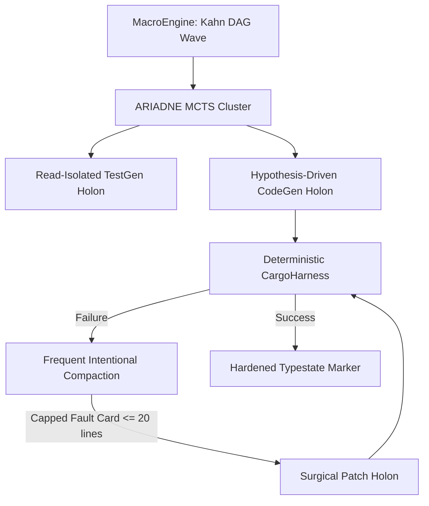

# 4 · Comparative Architectural Forensics: ReCodeAgent vs. werðan

## 4.1 ReCodeAgent Autopsy: Why Claude 3.5 Sonnet Failed on `cfsm`

Forensic analysis of ReCodeAgent's Zenodo trajectory (`recodeagent.crust.cfsm.c.rust/project_details.json`) reveals the precise structural collapse that trapped a frontier cloud model:

```text
2026-02-11 09:26:13,365 - orchestrator - INFO - Validation report shows FAIL status - issues need repair
2026-02-11 09:26:13,365 - orchestrator - INFO - Continuing to next iteration for repairs...
2026-02-11 09:26:13,365 - orchestrator - INFO - === Translation-Validation Loop: Iteration 2/5 ===
...
2026-02-11 10:08:58,843 - orchestrator - WARNING - Translation-validation loop did not converge after 5 iterations
2026-02-11 10:08:58,843 - orchestrator - INFO - Total Translator time: 1850.78 seconds
2026-02-11 10:08:58,843 - orchestrator - INFO - Total Validator time: 1250.11 seconds
```

### The Failure Mechanism:
1. **Unbounded Agentic Babble**: ReCodeAgent relied on Claude Code CLI executing bash commands in a subshell. Each iteration re-invoked the entire Translator agent with previous conversation context.
2. **Context Saturation & Forgetting**: Over 5 iterations, cumulative context grew into hundreds of thousands of tokens. Claude 3.5 Sonnet repeatedly forgot earlier lifetime fixes, re-introducing the same borrow checker error in `cfsm_transition`.
3. **Absence of Diagnostic Compaction**: The Validator dumped full compiler error logs into the Translator's prompt. The model became obsessed with cosmetic fixes in `test.rs` rather than repairing the type signature of `CfsmCtx<T>`.
4. **Rigid 5-Iteration Deadlock**: The orchestrator lacked intermediate backtracking, search tree pruning, or hypothesis branching. Once locked in a failing cycle, it burned 51.6 minutes and yielded total failure.

## 4.2 werðan's Structural Advantages

In contrast, werðan's DAEDALUS architecture prevents these failure modes through rigorous systems engineering:



1. **Typestate Statechart Isolation**: State transitions are enforced at compile time (`M0Blocked` $\to$ `M1Ready` $\to$ `M2Candidate` $\to$ `M4Hardened`). No agent can loop indefinitely outside the formal statechart transition rules.
2. **Deterministic Smart Zone Retention**: ADR-0018 Frequent Intentional Compaction strips 90% of raw compiler noise, ensuring the 27B model receives only precise error tokens and line spans.
3. **Strict Test/Code Read-Isolation**: Test generation holons never see candidate code, eliminating the self-validating tautologies and cheating observed in unconstrained agent baselines.
4. **Local Hardware Autonomy**: By optimizing prompt efficiency and search topologies, werðan achieves deterministic modernization on a consumer RTX 3090 without incurring cloud API costs or latency.
