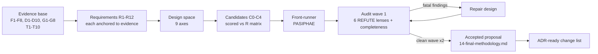

# 10 — Meta-Strategy: How "Optimal" Was Searched For

Companion to `README-methodology.md`. This file defines what "the optimal methodology" means for the werðan program, how the search for it was organized, and when the search stops. It is the protocol under which every downstream file (`11-requirements.md` … `16-audit-ledger.md`) was produced.

## 1. The problem, formally

Given a legacy repository $\mathcal{R}_{\text{leg}}$ in language $\mathcal{L}_{\text{src}}$ and a target specification $\mathcal{L}_{\text{tgt}}$, a methodology is a policy $\pi$ that transforms $\mathcal{R}_{\text{leg}}$ into $\mathcal{R}_{\text{tgt}}$ under an inference budget. We evaluate $\pi$ against one objective and three constraint families.

**Objective.** Maximize expected success per unit cost:

$$\pi^\star \;=\; \arg\max_\pi \; \frac{\Pr\big[\text{accept}(\mathcal{R}_{\text{tgt}})\big]}{\mathbb{E}\big[\,\text{cost}(\pi, \mathcal{R}_{\text{leg}})\,\big]}$$

- **accept = the four campaign criteria of `benchmarks/README.md` §6, computed from **one** harness receipt stream (compilation gate, 100% characterization pass, zero stubs, real-inference receipts) — the single-ground-truth requirement G4. Measurement-validity caveat (wave-1 audit, RefuteMeas F1): this objective is *oracle-relative*. The benchmark's native suites are weak (D1–D3), so $\pi^\star$ rewards policies that pass weak gates cheaply — the toml stub pass (F4) is the degenerate optimum. The methodology therefore **hardens accept from the inside** rather than optimizing the raw benchmark rate. Precise predicate (wave-2 fix, RecheckMeas F1): a module's receipt yields *hardened accept* iff (a) all four §6 criteria hold, (b) the suite passes stub-sensitivity (mandatory, every campaign), and (c) L2 differential parity meets the gate whenever the legacy program is executable (skel/crust: always) — gate: exact match on `require_byte_identical_io: true`, ≥0.95 normalized parity otherwise with normalization documented per receipt; for non-executable legacy, L4 verdict aggregation substitutes and the receipt labels `parity: verdict_only` (wave-3 W3-6). Mutation kills are a **spot-audit instrument** (RecheckScale F1: per-suite mutation across 100 modules is arithmetically out of bounds), not an accept precondition — but every receipt carries `oracle_strength ∈ {stub_sensitivity_only, stub_plus_mutation_audit, full}` and aggregate reporting separates the classes. Raw §6 rates are reported alongside for comparability and expected to drop when vacuous passes are rejected.
- **cost** = the conditional mixture, not an unconditioned product (wave-1 audit, RefuteMeas F2 — the naive product $\text{req}\times\text{tok}\times\text{wall}$ is dimensionally degenerate):

$$\text{cost} \;=\; \Pr[\text{succ}]\,\mathbb{E}[\text{cost} \mid \text{succ}] \;+\; (1-\Pr[\text{succ}])\,\mathbb{E}[\text{cost} \mid \text{fail}]$$

  measured in GPU-seconds (tokens / ~268 tok/s aggregate, discounted for slot contention — six concurrent workers share the 268 tok/s aggregate, so effective per-agent throughput degrades with fan-out) + deterministic tool time (builds, test execution, oracle runs). Operator attention is **dropped from the metric** (wave-2 fix, RecheckMeas F2: it is unobservable in receipts and made the objective non-estimable). Failure-cost asymmetry is first-class: locally, successful heapq cost 107 req / 3.2 h while failing toml burned 774 req / 17.1 h (>7× requests), matching SWE-Effi's >4× failed-rollout multiplier — low-$\Pr[\text{succ}]$ policies are penalized by the mixture, which is the point. **Role of the objective (same fix):** $\pi^\star$ is an *offline evaluation metric* used to rank methodology candidates across campaigns — the online scheduler runs deterministic policies (difficulty tiers, wave dispatch, wall-clock sub-budgets) and does not attempt fractional optimization intra-campaign; equating the two was the wave-1 model's flaw. Serving regime: ninfer, 6 slots, ~268 tok/s aggregate, 65k claimed / ~32k effective context per `LitEcon` S7–S11, 2 h per-campaign bound with the truncation semantics of §6 below.

**Constraint families.**
1. **Governance**: `METHODOLOGY.md` is read-only ground truth (ADR-0005); ADRs are append-only; specs sync with code in the same commit. Any change routes through a MADR ADR.
2. **Regime**: 27B-class SLM reasoner (`swift-1.5-qwen3.8-27b`), bounded effective context, single-GPU serving; dataset realities D1–D10; operational failures F1–F8; the VAL-* validation contract system.
3. **Honesty**: every quantitative claim in this report is either executed here, cited to a verified source, or marked `[INFERENCE]`. Simulated-receipt scoring (D10) is the anti-pattern this constraint exists to prevent.

## 2. Why a meta-strategy is needed at all

The incumbent (`THESEUS` in `METHODOLOGY.md`) was itself designed against a failure catalogue — but its own campaigns (F1–F8) and its own text (internal tensions T1–T10, see `LocalAudit` brief, §e) prove it is not fixed-point optimal: five of eight real campaigns died on engine-accounting artifacts, not translation difficulty, and the methodology's flagship formal guarantee ("$R=1.0$ is necessary and sufficient") is false under the weak oracles the benchmark ships. An optimal methodology cannot be declared; it must be **searched for and audited**. Three properties make the search tractable:

1. **The objective is measurable** — receipts, wall-clock, and pass rates are already recorded per campaign; failure taxonomy F1–F8 gives a validation set of *known* killers any candidate must survive.
2. **The design space is finite in its load-bearing dimensions** — topology, control locus, search procedure, oracle stack, memory substrate, translation-unit granularity, scheduling policy, model routing, honesty gates (§4).
3. **Adversarial convergence is executable** — a REFUTE pool of independent audit lenses (theory, scalability arithmetic, failure coverage, literature contradiction, feasibility, Pareto-simplicity, measurement validity) can kill a candidate; convergence = two consecutive waves with zero fatal findings.

## 3. Search procedure (what was actually done)

1. **Evidence-first requirements** (`11-requirements.md`): every requirement R* cites the failure it forecloses (F/D/G/T ids) and at least one literature anchor. Requirements not traceable to evidence or measurement need were dropped.
2. **Design-space enumeration** (`12-design-space.md`): nine axes, each with the options the literature has measured, and the axis positions the evidence forces.
3. **Candidate composition and scoring** (`13-candidates.md`): five candidates scored against the requirement matrix — C0 incumbent-as-implemented, C1 ReCodeAgent-style pipeline, C2 GVS5H ledger, C3 incumbent + G-gap repairs, C4 the hybrid front-runner.
4. **Adversarial audit** (`16-audit-ledger.md`): the front-runner was attacked by six independent lenses; every fatal/valid finding required a named disposition (fixed / accepted-with-rationale / rejected-with-counter-evidence). Convergence criterion: two consecutive clean waves.
5. **Journey** (`15-journey.md`): the versioned design narrative (v0 incumbent → v4 front-runner), with the audit finding that forced each change — the auditable trail of *why* the design moved.

## 4. Design-space axes (summary; detail in `12-design-space.md`)

| # | Axis | Options with measured evidence | Forced position (evidence) |
|---|---|---|---|
| A1 | Orchestration topology | free chat / pipeline / manager-worker / blackboard / ledger / statechart hybrid | hybrid (T1–T10; LbMAS, StateFlow, GVS5H) |
| A2 | Control locus | LLM-proposed (ReAct) / deterministic / learned (AFlow, MaAS) | deterministic shell + bounded agentic interiors (StateFlow +13–28% at 3–5× cheaper) |
| A3 | Intra-module search | greedy repair / MCTS / portfolio-race-then-commit | portfolio race + focused repair (Snell S12; noisy-binary-reward theory) |
| A4 | Oracle stack | exit-code / test-only / layered (symbolic → differential → adversarial → verdict) | layered (MockingBird 0-FP; ReCodeAgent 86.5 vs 97.8 gap) |
| A5 | Memory substrate | chat history / ledger files / blackboard slices / checkpointed state | blackboard + checkpointed events (GVS5H, Hearsay-II, LangGraph) |
| A6 | Translation-unit granularity | whole-file / sub-file block / fragment | sub-file with assembly contracts (D4) |
| A7 | Scheduling & budgets | uniform B_max / difficulty-adaptive | difficulty-adaptive + progress-gated continuation (F7; MaAS; Snell) |
| A8 | Model routing | single model / cascade | verification-capacity concentration (mechanized+procedural; ProST corrected per RefuteLit F2; S19 worker floor) |
| A9 | Honesty & measurement | none / receipts-as-decor / single-ground-truth gates | single-ground-truth gates (D9, D10, G4, G7) |

## 5b. Truncation semantics & termination (wave-1 audit: RefuteMeas F3, RefuteScale F4)

The 2 h per-campaign bound previously had no defined semantics when hit mid-flight, and R5's "reset on reward gain" had no progress quantum — both holes enable runaway loops (toml: 17.1 h, 774 requests, F7). Definitions for all downstream files:

- **Truncation.** The scheduler pre-reserves a tail budget $W_{\text{tail}} = \min(5\text{ min},\ 2\%\,W)$ before the bound fires; when it fires: (1) all in-flight solver dispatches are cancelled at the next micro-state boundary; (2) the *final harness pass* runs inside $W_{\text{tail}}$ on the best-known candidate per non-terminal module (one deterministic receipt each; candidates already carried receipts — the pass is bounded and, if $W_{\text{tail}}$ is insufficient, unscored modules keep their last existing receipt); (3) a non-terminal module is scored accept **only if its already-existing receipt chain already satisfies the full hardened-accept predicate** (§1) — no module invents acceptance evidence at truncation time (wave-2 fix, RecheckScale F5 / RecheckMeas F3: mid-flight candidates that passed only a bounded L2 probe or an unhardened suite classify partial-credit with their best oracle layer, e.g. `compiles_but_suite_weak`, never accept); (4) The terminal receipt carries `truncated: true` with per-module classification. Truncated campaigns are **measurements, not invalid runs**: discarding them inflates $\Pr[\text{accept}]$ by survivorship bias. Only honesty-gate violations (D10-class: simulated receipts, stub presence) invalidate a campaign outright. Resource-cap violations (OOM, restart-cap exhaustion) classify the campaign partial-credit with `resource_capped: true` — same reason: the expensive failure modes are the denominator that matters (RefuteMeas F3).
- **Progress quantum.** "Reward gain" resets a futile-cap counter only if the *absolute* gain over the vertex's best-known reward is at least one full characterization test's worth: $\Delta R \ge 0.6 / N_{\text{suite}}$ (canonical reward weights a passing test at $0.6/N$; wave-2 fix, RecheckMeas F4 — the previous fixed $\epsilon = 0.05$ discarded genuine single-test progress whenever $N > 12$, and a *relative* reading divides by zero at $R_{\text{best}} = 0$, the D5 synthesis case). Oracle-stage advancement (L0→L1→L2) also counts as progress and clears the counter — it does **not** consume a reset allowance. Stochastic flakiness below one test's worth never resets. Per vertex: at most $N_{\text{reset\_max}} = 3$ futile-cap resets; the reset counter is global per vertex, not per dispatch.
- **Global circuit breaker.** Every module dispatch executes under a module-level wall-clock sub-budget derived from the campaign bound and the difficulty tier (R10). Exhausting it forces the module into the terminal classification of the truncation paragraph above regardless of reset counters — a single pathological module (toml-class) cannot consume >~40% of campaign wall-clock (arithmetic in RefuteScale F4: 5 resets × 160 rollouts ≈ 50 min at 268 tok/s). **Race-restart budget semantics (wave-2 fix, RecheckTheory F2):** only *external* oracle changes (upstream test amplification, Tier-B-mandated retests) restart a pre-commit race; an intra-module oracle-stage advance never does (post-commit upgrades re-gate the winner through the existing gates; invalidation routes through the stall/revive machinery instead). A restart refunds nothing — it spends the same sub-budget — and a restart triggered by an external upgrade consumes one of the vertex's 3 reset allowances, so repeated upgrades hit the cap and terminalize rather than loop.

## 5. Epistemic status of the result

- **"Optimal" is bounded.** The claim delivered is: *no candidate in the audited space survives the audit waves while beating the front-runner on the requirement matrix under the stated cost model*. This is an audit-surviving optimum, not a proof of global optimality — the design space is discretized at the axis level, and cost is modeled, not measured end-to-end (no full PASIPHAE campaign has run yet; running it is the ADR-ready follow-up).
- **Residual risks** (carried into `16-audit-ledger.md`): (a) literature metrics import regimes different from ours (frontier models, API latency, different languages); (b) the dataset's own validity gaps (D5–D8, G8) mean success rates measured on it are oracle-relative; (c) five audit lenses are argumentative, not empirical — their findings are as strong as the evidence cited, and the ledger marks which dispositions rest on measurement vs argument.
- **What would falsify the result**: a full PASIPHAE campaign sweep on `skel` (8 projects) that fails to beat the v18 lineage's 1/8 honest pass rate at equal or lower wall-clock; a **token-matched single-agent-pooled baseline** (one 27B agent, same total output-token budget, same oracles) matching or beating PASIPHAE — the BenchAgent/Tran & Kiela challenge, scored as candidate C0-pooled in `13-candidates.md`; or an audit finding that a rejected candidate (e.g., C2 ledger) matches the front-runner with materially less machinery.

## 6. Non-goals

- Re-litigating ADR-0005 (read-only methodology) — this report proposes ADRs; it does not edit `METHODOLOGY.md`.
- New benchmark construction (G8 scopes what the current corpus can and cannot validate).
- Frontier-model scaling studies; the regime is fixed at 27B-class SLM on the local serving stack.
