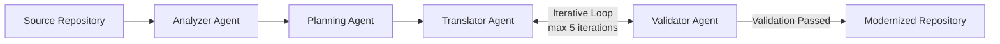

# 01 — The ReCodeAgent Paper & Theoretical Methodology

## 1. Paper Overview & Metadata

- **Title:** *ReCodeAgent: A Multi-agent Workflow for Language-Agnostic Translation and Validation of Large-Scale Repositories*
- **Authors:** Ali Reza Ibrahimzada, Brandon Paulsen, Daniel Kroening, Reyhaneh Jabbarvand
- **Venue:** Accepted at the 41st IEEE/ACM International Conference on Automated Software Engineering (**ASE 2026**), Munich, Germany
- **Preprint:** [arXiv:2604.07341](http://arxiv.org/abs/2604.07341)
- **Primary Research Objective:** Autonomous repository-level translation between programming languages with behavioral parity preservation, scaling beyond single-file or single-function translation benchmarks (e.g., HumanEval, CodeXGLUE).

---

## 2. Theoretical Architecture & Core Workflow

The paper formalizes repository translation as a sequential multi-agent orchestration pipeline consisting of four specialized LLM agents interacting through a shared workspace and deterministic tools:

### 2.1 Stage 1: Analyzer Agent (Structural & Semantic Discovery)
The Analyzer Agent explores the legacy codebase $\mathcal{R}_{\text{src}}$ using Language Server Protocol (LSP) queries and Tree-sitter Abstract Syntax Tree (AST) parsing:
1. **Directory & Module Topology:** Queries directory trees and file structures.
2. **Entity Extraction:** Identifies structs, classes, interfaces, function signatures, and global constants.
3. **Data Model Profiling:** Segregates internal domain data models from external I/O serialization formats (network packets, database schemas, file formats).
4. **Dependency Resolution:** Inspects third-party package manifests and standard library dependencies.
5. **Artifact Output:** Produces two markdown design artifacts in a designated planning directory:
   - `<source_lang>-project-research.md`: Comprehensive inventory of legacy components and interfaces.
   - `<target_lang>-overall-design.md`: Architectural blueprint defining target module layout, error-handling conventions, and library mapping.

### 2.2 Stage 2: Planning Agent (Topological Ordering & Scaffolding)
The Planning Agent bridges high-level architecture to implementation steps by establishing a strict bottom-up dependency order:
1. **Symbol Extraction:** Compiles `<source_lang>-functions.md`, listing every function, method, struct, and test in the repository.
2. **Name Mapping:** Emits `name-mapping.json`, mapping fully-qualified source identifiers to target identifier names.
3. **Skeleton Synthesis:** Generates empty target skeleton files matching the source directory structure, populated with stubbed declarations and type signatures.
4. **Dependency DAG Construction:** Parses imports and symbol call-graphs to build a directed dependency graph. Computes a topological sort such that each module $v_i$ is scheduled only after all upstream dependencies $\text{Parents}(v_i)$ have been synthesized.
5. **Implementation Plan:** Writes `implementation-plan.md`, divided into:
   - **Part A:** Sequential source translation tasks ordered by dependency depth.
   - **Part B:** Test translation and execution steps.

### 2.3 Stage 3: Translator Agent (Bottom-Up Synthesis)
The Translator Agent executes the implementation plan sequentially:
1. Translates functions and classes into the pre-generated skeleton files following the topological order.
2. Uses compiler diagnostics and Language Server Protocol tools (LSP hover, type checking, auto-completion) to verify syntactic and type-level correctness after each file edit.
3. Translates unit test files from the source suite into target-language test files, matching source assertions 1:1.
4. Executes the translated tests using target build tools (`cargo test`, `pytest`, `node`). If local tests fail, the agent applies in-place patches.

### 2.4 Stage 4: Validator Agent (Equivalence Verification & Repair Loop)
The Validator Agent serves as an adversarial quality gate before sign-off:
1. **Stub & Incomplete Code Detection:** Scans the codebase for placeholder markers (`unimplemented!()`, `pass`, `TODO`, `FIXME`).
2. **Name Preservation Audit:** Verifies that identifier names in the target match `name-mapping.json`.
3. **Test Parity Check:** Verifies that translated test suites contain identical assertion counts and assertion logic compared to source tests.
4. **Differential Test Generation:** For functions lacking test coverage in the source repository, the Validator generates parallel test cases in both source and target languages (`ClassNameTest_generated`), runs both, and verifies that both pass.
5. **Report Generation & Feedback:** Writes `validation-report.md` detailing any structural defects, failing tests, or stub markers.
6. **The Translation-Validation Loop:** If defects are detected, control returns to the Translator Agent with `validation-report.md` as feedback. The Translator-Validator loop iterates up to a hard cap of $K_{\max} = 5$ iterations. If all checks pass, `validation-summary.md` is emitted and the process terminates.

---

## 3. Claimed Benchmark Performance & Results

The paper evaluates ReCodeAgent across 118 real-world repositories grouped into four benchmark suites:
- **CRUST (C to Rust):** 100 repositories from the CRUST benchmark.
- **Oxidizer (Go to Rust):** 6 repositories translated to idiomatic safe Rust.
- **AlphaTrans (Java to Python):** 4 Apache Commons projects (`commons-cli`, `commons-csv`, `commons-fileupload`, `commons-validator`).
- **Skel (Python to JavaScript):** 8 utility and algorithmic repositories (`bst`, `colorsys`, `heapq`, `html`, `mathgen`, `rbt`, `strsim`, `toml`).

### Headline Paper Metrics vs. Baselines
The authors report that ReCodeAgent dramatically outperforms both direct LLM prompting (`BaseAgent`) and state-of-the-art software engineering agents (`SWE-agent`):
- Overall Test Pass Rate: ReCodeAgent claimed **80.5%** overall functional equivalence across all benchmarks, compared to <30% for unguided baselines.
- Ablation Findings: The authors claim that removing the Analyzer drops success by 18.4%, removing the Planner drops success by 23.1%, and removing the Validator drops success by 31.7%, arguing that every agent in the 4-stage pipeline is essential.

---

## 4. Fundamental Theoretical Assumptions

The ReCodeAgent paradigm rests on three core theoretical assumptions:
1. **Monotonic Feed-Forward Viability:** The planning phase can construct an accurate, acyclic dependency order prior to code translation, and downstream compilation or runtime discoveries will never invalidate upstream architectural decisions.
2. **Context Window Sufficiency:** The reasoning context required for repository translation can be accommodated in linear conversational sessions by relying on LLM context windows without programmatic state persistence.
3. **Oracle Equivalence Sufficiency:** Differential execution of identical inputs across source and target programs without formal property verification or state invariants is sufficient to prove behavioral equivalence.

As demonstrated in subsequent chapters of this report, all three assumptions break down under empirical scrutiny—especially when shifting from frontier LLMs to local Small Language Models.
