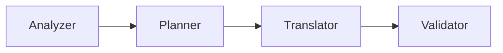
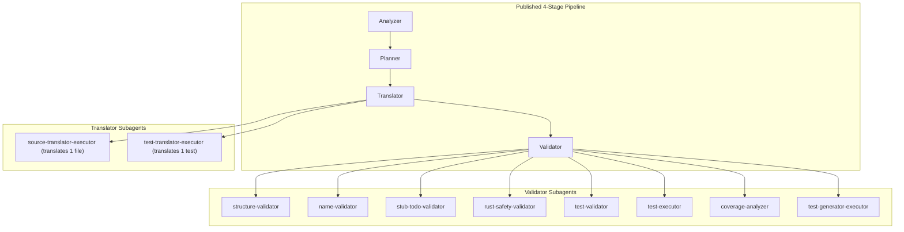

# 04 — Implementation Drifts: Discrepancies Between Paper Claims and Repository Reality

A rigorous audit of the ReCodeAgent codebase (`benchmarks/assets/ReCodeAgent/`), prompt templates (`configs/prompt_templates.yaml`), and Zenodo execution traces reveals **five major implementation drifts** where the published paper claims diverge sharply from what was actually implemented and executed.

---

## Drift 1: The "CRUST" Human Scaffolding Shortcut (85% of Evaluation Dataset)

### The Paper Claim
The paper claims ReCodeAgent autonomously translates complete legacy repositories $\mathcal{R}_{\text{src}}$ into modernized target repositories $\mathcal{R}_{\text{tgt}}$, extracting directory structure, defining target types, synthesizing interfaces, and translating test suites:
> *"ReCodeAgent employs specialized agents (Analyzer, Planning, Translator, Validator) that work together to understand source code structure, plan the translation strategy, implement the translation, and validate functional equivalence across multiple languages."* (Paper §1, Abstract)

### The Reality in Code & Prompts
In reality, **100 of the 118 benchmark projects (84.7%) belong to CRUST (C-to-Rust)**. For CRUST, the repository translation problem was largely pre-solved by human software engineers prior to agent execution:
1. **Target Skeletons Pre-Written:** Complete Rust module structures, `Cargo.toml` configurations, struct declarations, lifetime annotations, and method signatures were already written. Every function to be translated contained an explicit `unimplemented!()` macro.
2. **Test Suites Pre-Written & Human-Verified:** Complete test suites were already written in Rust under `src/bin/*.rs` by human annotators.
3. **Explicit Agent Instructions to Bypass Discovery:**
   In `configs/prompt_templates.yaml` (lines 102, 175, 218, 251, 312, 317):
   ```yaml
   - For CRUST projects, functions are already extracted and available in the target translation directory.
     Each function that requires implementation has `unimplemented!()` in its body, so only focus on those functions.
     DO NOT re-extract functions from the source project.
     Tests are already translated and validated by a human validator; DO NOT translate tests again.
   - For CRUST projects, there are already target skeleton files in the target translation root.
     DO NOT create new skeleton files.
   - For CRUST projects: Tests are already translated and available under src/bin.
     DO NOT include test translation steps in PART B for CRUST projects.
   - You MUST only change the unimplemented!() blocks to implement the functionality.
   ```

### Methodological Consequence
For 85% of its benchmark, ReCodeAgent is **not** performing repository-scale modernization. It is executing **isolated function-body completion** inside human-designed Rust type scaffolds. The difficult architectural challenges—resolving dynamic memory ownership, designing Rust structs to replace raw C pointers, mapping circular header includes into Rust modules, and writing idiomatic test assertions—were pre-solved by humans.

---

## Drift 2: The "Shadow Subagent Army"

### The Paper Claim
The paper presents an elegant, 4-node feed-forward architecture: Analyzer $\to$ Planner $\to$ Translator $\to$ Validator.



### The Reality in Code & Prompts
Inspection of `configs/prompt_templates.yaml` and the Zenodo session files reveals that the Translator and Validator are not monolithic agents. Instead, they act as supervisors orchestrating an unacknowledged **shadow army of 10 specialized subagents** spawned via Claude Code CLI:



The prompt explicitly instructs the Validator:
```yaml
CRITICAL: You MUST use subagents to perform validation tasks.
Each subagent handles one specific validation responsibility and terminates after completing its task.
This prevents memory loss from doing too many tasks in sequence.
```

### Methodological Consequence
The paper's reported token efficiencies and architectural comparisons against "monolithic" agents are misleading. The framework is actually a **hierarchical multi-agent system** with dynamic subagent spawning, hiding massive conversational context fragmentation and token consumption inside Claude Code subprocesses.

---

## Drift 3: Strict Identifier Name-Preservation vs. Idiomatic Target Code

### The Paper Claim
The paper claims to produce clean, idiomatic translations in the target language.

### The Reality in Prompts
In `configs/prompt_templates.yaml` (lines 67–69, 150–154, 256–260, 382–383):
```yaml
CRITICAL NAMING RULE - PRESERVE SOURCE NAMES EXACTLY:
- DO NOT rename identifiers when mapping from source to target.
- Class, method, function, and variable names in the target MUST be IDENTICAL to the source.
- Do NOT convert between naming conventions (e.g., do NOT change snake_case to camelCase or vice versa).
- The translated code MUST use the EXACT same identifier names as the source code.
```

### Methodological Consequence
This rule actively harms target-language idiomatic quality:
- Translating C or Python code to Java forces Java methods to use `snake_case` (e.g., `calculate_tax_value()`), which triggers warnings in standard Java linters (`Checkstyle`) and breaks Java Beans conventions.
- Translating Java to Go forces lowercase method names, which in Go changes **package visibility** (unexported vs. exported), causing external consumers to fail to compile.
- The rule was imposed not for engineering quality, but to make automated test harness matching trivially computable via simple string equality.

---

## Drift 4: In-The-Loop Meta-Scripting in the Planning Agent

### The Paper Claim
The paper describes the Planning Agent as performing automated AST analysis and dependency sorting.

### The Reality in Code
The Planning prompt requires the LLM to write, execute, debug, and delete temporary Python scripts in bash during execution:
```yaml
VALIDATION-IN-THE-LOOP REQUIREMENT:
1. Write Validation Script: Create {{ planning_dir }}/validate_functions.py
2. Execute Validation and Iterate: Run script, fix errors, re-run until passing
3. Create Validation Report: Document confirmation of full extraction
4. Cleanup: DELETE {{ planning_dir }}/validate_functions.py
DO NOT proceed to Step 3 until validation script passes and is deleted.
```
The same procedure is repeated for `validate_skeleton_and_mapping.py`.

### Methodological Consequence
This introduces extreme fragility:
- If the LLM produces a syntax error in its validation script, it spends multiple reasoning turns debugging the script rather than the project.
- While Claude 3.5 Sonnet handles this bash ceremony adequately, Small Language Models (SLMs) almost universally get confused: they forget to delete the script, hallucinate file paths, or terminate early assuming the task is finished.

---

## 5. Drift 5: Synthetic Oracle Equivalence & Weak Oracles

### The Paper Claim
The paper claims functional equivalence is verified through automated test generation and validation:
> *"For functions lacking test coverage, ReCodeAgent generates test cases in both languages to ensure comprehensive validation."* (Paper §2.4)

### The Reality in Execution Traces
Inspecting generated test files (`ClassNameTest_generated.*`) in Zenodo traces:
1. **Parallel Blind Generation:** The `test-generator-executor` subagent generates tests in both languages based purely on function signatures.
2. **Vacuous Acceptance:** The verification condition is simply:
   ```yaml
   If BOTH source and target tests pass → Functional equivalence verified
   ```
3. **No Differential Fuzzing or Assertions:** Many generated tests contain zero assertions, simply verifying that calling `obj.method()` does not panic or raise an uncaught exception.
4. **Pre-Existing Suites are Minimal:** In 40+ CRUST projects, the entire ground-truth test suite consists of a single `#[test]` function asserting 1–2 trivial inputs. Passing this test offers no guarantee of domain behavioral parity.
