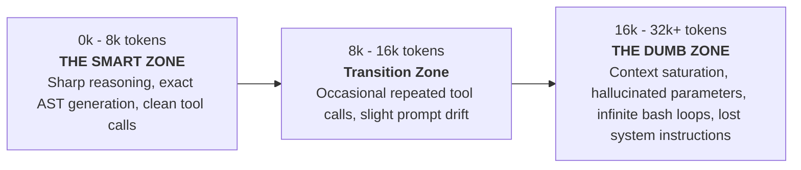

# 05 — Methodological Failures & The Small Language Model (SLM) Frontier

## 1. The Frontier Model Assumption & The "Forgiveness" Illusion

ReCodeAgent achieved its reported benchmark results by pairing a loose, feed-forward orchestration topology with **frontier-tier commercial reasoning models**—specifically Anthropic's **Claude 3.5 Sonnet** and **Claude Haiku 4.5**, accessed via AWS Amazon Bedrock:
- **Context Window:** 200,000 tokens.
- **Reasoning Capacity:** State-of-the-art coding and tool-calling benchmark scores (SWE-bench Verified >50%).
- **Prompt Tolerance:** Capable of reading 3,000-word Jinja2 prompt templates full of contradictory constraints, bash scripting instructions, and benchmark-specific exceptions.

Because the underlying model possessed frontier reasoning and a massive context window, the **weaknesses of ReCodeAgent's methodology were masked**:
- When the Planning Agent produced an ambiguous plan, Claude 3.5 Sonnet used bash and file search tools to dynamically discover missing dependencies.
- When the Validator generated imperfect tests, Claude 3.5 Sonnet self-corrected in-the-loop.
- When context accumulated over 50+ tool turns, the 200k context window prevented context exhaustion.

**However, when deploying this methodology on a local Small Language Model (SLM)**—such as a 27B-parameter dense or MoE model (`swift-1.5-qwen3.8-27b`) on consumer or workstation hardware (e.g., a single NVIDIA RTX 3090)—ReCodeAgent's methodology fails completely.

---

## 2. Failure Mode Analysis on Small Language Models (SLMs)

### Failure 1: Context Degradation & The "Dumb Zone" Trap
Small Language Models exhibit a sharp performance cliff governed by context length:

1. **ReCodeAgent's Prompt Bloat:** ReCodeAgent's prompt templates alone consume 2,500 to 4,000 tokens before any source code or file contents are injected.
2. **Unchecked Turn Accumulation:** Claude Code CLI appends every tool call, file read, compiler diagnostic, and bash output into a linear conversation history. By turn 15, the conversation exceeds 20,000 tokens.
3. **The Dumb Zone Collapse:** In the 27B SLM regime, entering the "Dumb Zone" causes the model to:
   - Re-read the same file repeatedly without making edits.
   - Emit invalid JSON or malformed tool call syntax.
   - Forget negative constraints (e.g., re-introducing raw pointers in safe Rust).
   - Hallucinate that a compilation error was resolved when it was not.

### Failure 2: The Absence of "Frequent Intentional Compaction"
ReCodeAgent has **no mechanism for context compaction**. It relies entirely on the model provider's context window.
- **The Necessary Solution:** For an SLM to maintain high reasoning quality over long repository transformations, the architecture must implement **Frequent Intentional Compaction**:
  - After each tool execution or verification cycle, ephemeral tool traces and compiler dumps must be pruned.
  - Key semantic discoveries (e.g., type definitions, extracted business rules, failing assertion diffs) must be distilled into compact, structured state records on a persistent Blackboard.
  - The active conversation context is wiped and re-hydrated with a minimal "Task Activation Envelope" ($\le 4\text{k tokens}$), keeping the SLM permanently in its **Smart Zone**.

### Failure 3: Feed-Forward Rigidity & The 5-Iteration Repair Trap
ReCodeAgent models repository modernization as a feed-forward pipeline:
$$\text{Analyzer} \longrightarrow \text{Planner} \longrightarrow \text{Translator} \longleftrightarrow \text{Validator}$$
- **The Architectural Flaw:** There are no backward topological control edges from the Translator/Validator back to the Planner or Analyzer.
- **Empirical Demonstration in Campaigns:**
  - If the Planner orders Module B before Module A, or fails to detect that Module B imports an unexported type from Module A, the Translator enters an impossible situation.
  - The Translator-Validator loop attempts to patch Module B locally. Because the defect is structural (an upstream interface mismatch), local patching fails.
  - After 5 iterations, ReCodeAgent exhausts its retry budget and aborts, leaving the repository broken.
- **Contrast with Hierarchical Statecharts:** A resilient methodology must support multi-tier regressions (Tier B cross-module interface renegotiation and Tier C SCC cycle condensation with Deep History $H^*$), allowing the engine to backtrack topologically rather than looping fruitlessly.

### Failure 4: Fragility of In-The-Loop Meta-Scripting
As documented in `04-implementation-drifts.md`, ReCodeAgent instructs agents to write temporary Python validation scripts in bash (`validate_functions.py`, `validate_skeleton_and_mapping.py`), execute them, and delete them.
- Frontier models execute this multi-step bash dance reliably.
- SLMs frequently trip: they write scripts with syntax errors, misinterpret tracebacks, forget to delete the script, or enter an infinite loop trying to debug the script that was supposed to validate their code.
- Validation should be executed by **deterministic host tooling** (compiled Rust validators, static linters, deterministic DAG checkers), never delegated to stochastic LLM meta-scripts.

### Failure 5: Single-Draft Greediness vs. Multi-Branch Search
ReCodeAgent is a single-trajectory greedy solver: it generates one target draft and linearly applies diff patches.
- If the initial translation hypothesis for a complex legacy module is architecturally flawed (e.g., trying to translate a stateful C callback system into Rust without interior mutability), linear patching leads to spaghetti workarounds.
- A robust SLM architecture must decouple strategy generation from code synthesis and utilize **Monte Carlo Tree Search (MCTS)** or portfolio exploration (e.g., ARIADNE / Softmax-UCB), allowing the engine to abandon dead-end implementation branches cleanly.

---

## 3. Summary: What werðan Must Overcome

| Dimension | ReCodeAgent Approach | Why It Fails on SLMs | Required werðan Architecture |
|---|---|---|---|
| **Control Topology** | Static feed-forward + 5-iteration local loop | Trapped in local repair loops on structural errors | Two-Tier Harel Statechart with broadcast events and Deep History ($H^*$) |
| **Context Management** | Linear uncompacted conversation buffer | Saturates SLM context into the "Dumb Zone" (>16k tokens) | Frequent Intentional Compaction via Task Activation Envelopes |
| **State Persistence** | Transient markdown files in `planning/` | Markdown files get corrupted, desynchronized, or lost | Strongly-typed, transactional Blackboard ($\mathcal{G}$ and local $\mathcal{B}^{(v_i)}$) |
| **Planning Validation** | Stochastic LLM-written Python meta-scripts | SLMs write buggy scripts and get trapped debugging them | Zero-token deterministic structural guards ($g_{\text{struct}}$) |
| **Search Procedure** | Single-trajectory greedy diff patching | Cannot recover from flawed initial refactoring strategies | Encapsulated MCTS solver (Softmax-UCB) exploring distinct hypotheses |
| **Oracle Verification** | Synthetic generated tests (exit-code 0) | Vacuous tests pass trivially; ignores semantic drift | Layered oracles with differential I/O, property tests, and stub sensitivity |
