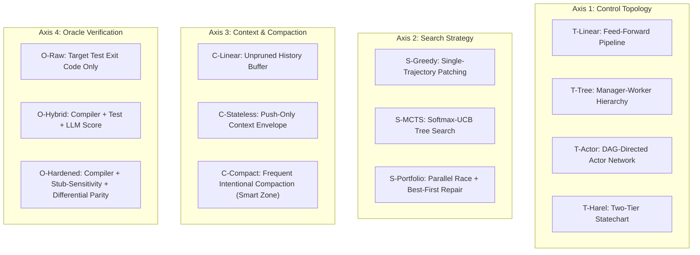

# 04 — Bounded Alternative-Methodology Design Space

To systematically discover Pareto-optimal methodologies for repository modernization under the 27B SLM / single-GPU regime, we define a bounded multi-dimensional design space across six architectural axes.

---

## 1. Architectural Dimensions & Value Sets

### Dimension 1: Agent Topology & Communication Graph ($\mathcal{T}$)
- **$\mathcal{T}_{\text{pipe}}$ (Static Feed-Forward Pipeline):** Linear DAG of specialist agents passing documents forward (e.g., ReCodeAgent). Minimal communication overhead; zero topological backtracking.
- **$\mathcal{T}_{\text{tree}}$ (Manager-Worker Hierarchy):** Central supervisor LLM managing a task ledger and dispatching leaf workers sequentially (e.g., GVS5H). High centralization bottleneck; lossy vertical summaries.
- **$\mathcal{T}_{\text{actor}}$ (Dependency-Directed Actor Network):** Each translation unit (module/SCC) is an autonomous Actor communicating via typed messages along edges mirroring the codebase's import graph. Fully decentralized; maximum branch parallelism.
- **$\mathcal{T}_{\text{harel}}$ (Two-Tier Harel Statechart):** Deterministic statechart engine managing XOR macro-phases and concurrent orthogonal regions for modules, with broadcast event calculus (the Incumbent).

### Dimension 2: Intra-Module Search & Planning Strategy ($\mathcal{S}$)
- **$\mathcal{S}_{\text{greedy}}$ (Single-Trajectory Greedy Patching):** Generates one candidate and applies linear iterative diff patches based on compiler/test errors (ReCodeAgent, SWE-agent). Minimal tokens per step; prone to dead-end local minima.
- **$\mathcal{S}_{\text{mcts}}$ (Monte Carlo Tree Search):** Tree search with Softmax-UCB exploration balancing strategy generation ($\mathcal{A}_{\text{str}}$), code generation ($\mathcal{A}_{\text{gen}}$), and repair ($\mathcal{A}_{\text{patch}}$) (ARIADNE / Incumbent). High theoretical optimality; massive token and wall-clock cost.
- **$\mathcal{S}_{\text{portfolio}}$ (Budgeted Portfolio Race with Best-First Repair):** Spawns $K \in [2, 4]$ diverse translation hypotheses in parallel, evaluates all candidates with zero-token compiler gates, selects the highest-scoring candidate, and executes surgical repair. Slashes tree-search branching while avoiding greedy single-draft traps.

### Dimension 3: Context Management & Memory Substrate ($\mathcal{M}$)
- **$\mathcal{M}_{\text{unpruned}}$ (Linear Unpruned Conversation):** Conversational agent appends all tool calls and compiler logs into context (Claude Code / ReCodeAgent). Rapidly enters the SLM "Dumb Zone" (>16k tokens).
- **$\mathcal{M}_{\text{stateless}}$ (Push-Based Hydration):** Workers are strictly stateless functions hydrated with 1-hop blackboard slices (Incumbent). Prevents session drift, but lacks structured compaction between repair turns.
- **$\mathcal{M}_{\text{compact}}$ (Frequent Intentional Compaction Protocol):** Enforces a hard context ceiling ($\le 12\text{k tokens}$) to keep SLMs permanently inside their "Smart Zone". Ephemeral compiler stack traces and diff histories are distilled into structured fault summaries after each step; the active conversation buffer is wiped and re-hydrated.

### Dimension 4: Verification Oracle Stack ($\mathcal{O}$)
- **$\mathcal{O}_{\text{raw}}$ (Raw Test Execution):** Relies solely on `target_test_cmd` exit code (ReCodeAgent baseline). Highly vulnerable to stub-collapse gaming (F4).
- **$\mathcal{O}_{\text{hybrid}}$ (Compiler + Characterization Tests + LLM Critic):** Conjoins deterministic compiler checks with an LLM-evaluated parity score (Incumbent). Suffers from reward calibration disconnects (F3).
- **$\mathcal{O}_{\text{hardened}}$ (Layered Hardened Oracle):** Strictly ordered short-circuiting pipeline:
  1. Target compiler & linter (zero tokens).
  2. Stub-Sensitivity Gate: Test suite must fail against an empty/collapsed stub.
  3. Differential Parity Gate: Normalized output equivalence ($\ge 0.95$) against legacy execution for identical inputs.
  4. Spot-Audit Mutation Testing: Verification that mutants are killed.

### Dimension 5: Regression & Recovery Calculus ($\mathcal{R}$)
- **$\mathcal{R}_{\text{none}}$ (Fail-Fast / No Backtracking):** If translation fails or invalidates upstream contracts, the project fails (ReCodeAgent).
- **$\mathcal{R}_{\text{global}}$ (Monolithic Phase Rollback):** Any cross-module defect rolls back the entire repository to an earlier global phase.
- **$\mathcal{R}_{\text{harel}}$ (Three-Tier Broadcast Calculus):** Tier A (local backtrack), Tier B (broadcast event along DAG edge), Tier C (macro-regression with Deep History $H^*$) (Incumbent).
- **$\mathcal{R}_{\text{p2p}}$ (Decentralized Peer-to-Peer Contract Renegotiation):** Downstream module sends a typed `ContractNegotiate` message directly to upstream parent; parent warm-starts repair on its existing candidate without global orchestrator interruption.

---

## 2. Mandatory Trivial & Reference Baselines

To ensure rigorous evaluation and prevent strawman comparisons (per baseline-typicality guidelines), any candidate set must include:
1. **B1: Flat Feed-Forward Pipeline (ReCodeAgent-style):** $\langle \mathcal{T}_{\text{pipe}}, \mathcal{S}_{\text{greedy}}, \mathcal{M}_{\text{unpruned}}, \mathcal{O}_{\text{raw}}, \mathcal{R}_{\text{none}} \rangle$.
2. **B2: Manager-Worker with Ledger (GVS5H-style):** $\langle \mathcal{T}_{\text{tree}}, \mathcal{S}_{\text{greedy}}, \mathcal{M}_{\text{stateless}}, \mathcal{O}_{\text{raw}}, \mathcal{R}_{\text{global}} \rangle$.
3. **B3: Incumbent Methodology (`THESEUS`):** $\langle \mathcal{T}_{\text{harel}}, \mathcal{S}_{\text{mcts}}, \mathcal{M}_{\text{stateless}}, \mathcal{O}_{\text{hybrid}}, \mathcal{R}_{\text{harel}} \rangle$.
