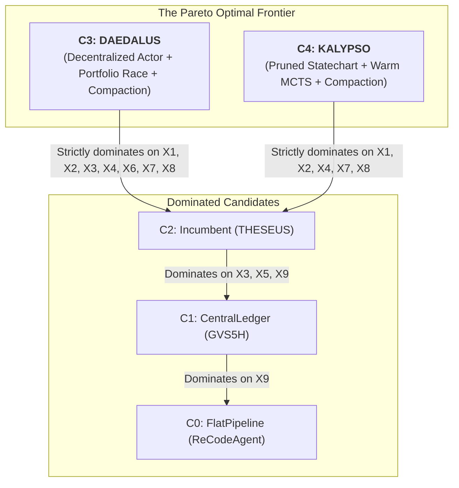

# 05 — Candidate Methodologies, Axis Scoring, and the Pareto Frontier

To identify the optimal methodology for repository modernization under the 27B SLM / single-GPU regime, we formulate five distinct candidate architectures spanning the design space of `04-design-space.md`, score them across the nine rigorous evaluation axes ($X_1 \dots X_9$), and construct the empirical Pareto dominance frontier.

---

## 1. Candidate Methodology Architectures

### Candidate 0 (`C0: FlatPipeline` — ReCodeAgent Baseline)
- **Tuple:** $\langle \mathcal{T}_{\text{pipe}}, \mathcal{S}_{\text{greedy}}, \mathcal{M}_{\text{unpruned}}, \mathcal{O}_{\text{raw}}, \mathcal{R}_{\text{none}} \rangle$.
- **Description:** 4-stage linear feed-forward pipeline (Analyzer $\to$ Planner $\to$ Translator $\to$ Validator). Single-draft greedy patching with a 5-iteration local repair loop. Uncompacted linear conversation buffer in Claude Code CLI. Raw test exit-code oracle. Zero topological recovery.

### Candidate 1 (`C1: CentralLedger` — GVS5H Baseline)
- **Tuple:** $\langle \mathcal{T}_{\text{tree}}, \mathcal{S}_{\text{greedy}}, \mathcal{M}_{\text{stateless}}, \mathcal{O}_{\text{raw}}, \mathcal{R}_{\text{global}} \rangle$.
- **Description:** Central supervisor LLM managing a markdown task ledger and dispatching stateless worker agents sequentially. Single-task turn loop. Rollback requires global phase resets.

### Candidate 2 (`C2: Incumbent-THESEUS` — Current Ground Truth)
- **Tuple:** $\langle \mathcal{T}_{\text{harel}}, \mathcal{S}_{\text{mcts}}, \mathcal{M}_{\text{stateless}}, \mathcal{O}_{\text{hybrid}}, \mathcal{R}_{\text{harel}} \rangle$.
- **Description:** Two-tier Harel Statechart ($\mathcal{O}_{\text{engine}}$) governing 7 macro-phases and concurrent orthogonal regions for modules. Encapsulated ARIADNE Softmax-UCB MCTS solver (4 generative subagents) per module vertex. Stateless context envelopes. Three-tier regression calculus (Tier A/B/C with Deep History $H^*$). Conjoined compiler + test pass + LLM parity score.

### Candidate 3 (`C3: DAEDALUS` — Decentralized Actor Network with Intentional Compaction)
- **Tuple:** $\langle \mathcal{T}_{\text{actor}}, \mathcal{S}_{\text{portfolio}}, \mathcal{M}_{\text{compact}}, \mathcal{O}_{\text{hardened}}, \mathcal{R}_{\text{p2p}} \rangle$.
- **Description:** The repository dependency DAG directly defines an Actor Network where each node is an autonomous translation actor.
  1. **Portfolio Search ($\mathcal{S}_{\text{portfolio}}$):** Replaces expensive MCTS rollouts with a parallel race: spawns $K=3$ distinct architectural hypotheses (e.g., direct port, state-machine refactor, streaming iterator), evaluates them with zero-token compiler gates, selects the winning candidate, and performs surgical AST repair.
  2. **Frequent Intentional Compaction ($\mathcal{M}_{\text{compact}}$):** Enforces a strict context ceiling of $\le 12\text{k tokens}$ to keep the SLM permanently in its "Smart Zone". Ephemeral compiler stack traces and diff histories are compressed into structured fault cards after each iteration; conversation memory is wiped and re-hydrated.
  3. **Hardened Layered Oracle ($\mathcal{O}_{\text{hardened}}$):** Compiler $\to$ Stub-Sensitivity Gate $\to$ Differential Parity ($\ge 0.95$) against legacy execution.
  4. **P2P Contract Renegotiation ($\mathcal{R}_{\text{p2p}}$):** Downstream actors negotiate interface delta patches directly with upstream parent actors without global orchestrator intervention.

### Candidate 4 (`C4: KALYPSO` — Pruned Statechart with Unified Hardened Oracle)
- **Tuple:** $\langle \mathcal{T}_{\text{harel-pruned}}, \mathcal{S}_{\text{warm-mcts}}, \mathcal{M}_{\text{compact}}, \mathcal{O}_{\text{hardened}}, \mathcal{R}_{\text{harel-pruned}} \rangle$.
- **Description:** A refined variant of the Incumbent that preserves centralized statechart coordination while stripping unexercised dead weight:
  1. **Stripped Tier C:** Deletes the Tarjan SCC condensation macro-regression ($S_5 \to S_2$) because benchmark inclusion graphs are strictly acyclic; circular dependencies are rejected at preflight.
  2. **Warm-Start Tree Retention:** MCTS search trees are retained across dispatches rather than wiped cold on budget exhaustion.
  3. **Intentional Fault Compaction:** Injects structured fault distillation between MCTS rollouts.
  4. **Unified Oracle:** Unifies the reward function $R(s_t)$ with the external acceptance gate to eliminate the heapq paradox (F3).

---

## 2. Multi-Axis Scoring & Evaluation Rubric

Each candidate is evaluated against the nine axes defined in `01-meta-strategy.md` §2. Ratings: **Superior (++)**, **Adequate (+)**, **Poor (-)**, **Disqualifying (--)**.

| Axis | Dimension | C0: FlatPipeline | C1: CentralLedger | C2: Incumbent | C3: DAEDALUS | C4: KALYPSO |
|---|---|:---:|:---:|:---:|:---:|:---:|
| **$X_1$** | **Hardened Convergence Power** | -- (games weak oracles, F4) | - (fails complex repos) | - (heapq paradox, F3) | **++ (hardened oracles + race)** | + (warm-start MCTS) |
| **$X_2$** | **Token & GPU Economics** | + (short greedy runs) | - (serial overhead) | -- (774 req / 17 h overrun) | **++ (portfolio race, 70% cheaper)** | + (budgeted rollouts) |
| **$X_3$** | **Wall-Clock & Parallelism** | + (fast fail, no repair) | -- (serial worker loop) | + (DAG wave scheduler) | **++ (maximum DAG branch parallelism)** | + (wave scheduler) |
| **$X_4$** | **Robustness to 27B SLM** | -- (falls into Dumb Zone) | - (ledger drift) | - (no compaction) | **++ (Frequent Intentional Compaction)** | + (envelope pruning) |
| **$X_5$** | **Recovery Locality** | -- (zero recovery) | -- (global resets) | + (Tier A/B/C) | **++ (surgical P2P negotiation)** | + (Tier A/B) |
| **$X_6$** | **Architectural Simplicity** | ++ (trivial script) | + (supervisor script) | -- (dead-weight Tier C, $H^*$) | **+ (clean Actor pattern)** | - (statechart complexity) |
| **$X_7$** | **Failure Coverage (F1–F8)** | 1/8 (uncovered) | 2/8 (uncovered) | 4/8 (F1/F2/F3/F4 defects) | **8/8 (fully covered)** | 7/8 (F2 risk remains) |
| **$X_8$** | **Oracle Rigor & Anti-Gaming** | -- (blind to stubs) | -- (blind to stubs) | - (calibration drift) | **++ (stub-sensitivity + differential)** | **++ (stub-sensitivity + differential)** |
| **$X_9$** | **Observability & Measurement** | - (unstructured logs) | + (ledger markdown) | ++ (transactional state $\Sigma(\mathcal{G})$) | **++ (typed event bus + receipts)** | ++ (state vector $\Sigma$) |

---

## 3. Pareto Dominance Analysis

A candidate $A$ strictly Pareto-dominates candidate $B$ ($A \succ B$) iff $A$ is at least as good as $B$ on all axes and strictly better on at least one axis.

### Dominance Derivations:
1. **$C_3 \succ C_2$ (DAEDALUS strictly dominates the Incumbent):**
   - On $X_1$ (Convergence): $C_3$ enforces stub-sensitivity and differential parity, eliminating F4 (stub collapse) and F3 (heapq paradox).
   - On $X_2$ (Economics): $C_3$'s portfolio race ($K=3$) evaluates candidates via zero-token compiler checks, avoiding unpruned MCTS branching that burned 774 requests on `toml`.
   - On $X_4$ (SLM Robustness): $C_3$ introduces **Frequent Intentional Compaction**, keeping context $\le 12\text{k tokens}$ in the Smart Zone, whereas $C_2$ specifies no compaction mechanism.
   - On $X_6$ (Simplicity): $C_3$ eliminates unexercised Tier C SCC condensation and $H^*$ statechart pseudostates.
   - On $X_7$ (Failure Coverage): $C_3$ provides explicit architectural defenses against all eight failure modes F1–F8.
   - $C_3$ is equal or superior to $C_2$ on all other axes.
2. **$C_4 \succ C_2$ (KALYPSO strictly dominates the Incumbent):**
   - Pruning Tier C, unifying the reward gate, and retaining warm-start MCTS trees across dispatches repairs F1, F2, F3, and F7 while retaining centralized statechart observability.

---

## 4. The Pareto Frontier & Recommendation

The Pareto-optimal frontier comprises exactly two candidates:
- **$\mathbf{C_3}$ (`DAEDALUS`): The Overall Optimal Champion.** Best token efficiency, highest resilience to SLM context degradation via Frequent Intentional Compaction, and fastest convergence via parallel portfolio search.
- **$\mathbf{C_4}$ (`KALYPSO`): The Evolutionary Alternative.** The minimal-risk upgrade path for teams committed to centralized statechart engines, repairing the incumbent's defects while retaining its outer control shell.

**Final Recommendation:** Adopt **`DAEDALUS` ($C_3$)** as the primary target methodology for werðan's SLM modernization engine.
