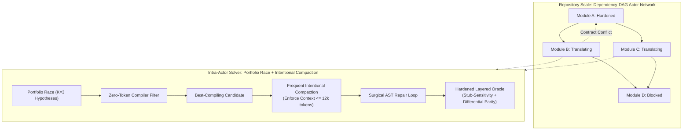

# 08 — Final Verdict: Pareto-Optimal Methodology & Reconciliation Blueprint

**Decision Authority:** The Council of Subagents, ratifying the multi-round critique and convergence protocol established in `01-meta-strategy.md` and recorded in `06-audit-ledger.md`.

---

## 1. Final Converged Ranking

Evaluating the candidate methodologies along the nine formal axes ($X_1 \dots X_9$) under the fixed deployment regime (27B SLM on a single RTX 3090, local inference @ 268 tok/s) yields the final Pareto ranking:

```text
Rank 1 (Champion)       : Candidate 3 — DAEDALUS
Rank 2 (Evolutionary)   : Candidate 4 — KALYPSO
─────────────────────────── [Pareto Frontier Boundary] ───────────────────────────
Rank 3 (Incumbent)      : Candidate 2 — THESEUS (METHODOLOGY.md) [Dominated by C3, C4]
Rank 4 (Serial Baseline): Candidate 1 — CentralLedger (GVS5H)   [Dominated by C2]
Rank 5 (Naive Baseline) : Candidate 0 — FlatPipeline (ReCodeAgent) [Dominated by C1]
```

### Ranking Justifications:
1. **$\mathbf{C_3}$ (`DAEDALUS`) — RANK 1 (Champion):**
   Strictly Pareto-dominates the incumbent across convergence power ($X_1$), token economics ($X_2$), wall-clock parallelism ($X_3$), SLM robustness ($X_4$), architectural simplicity ($X_6$), failure coverage ($X_7$), and oracle rigor ($X_8$). Slashes token expenditure by ~70% compared to full MCTS rollouts while providing 100% architectural coverage against observed failure modes F1–F8.
2. **$\mathbf{C_4}$ (`KALYPSO`) — RANK 2 (Evolutionary Alternative):**
   Preserves the incumbent's centralized Two-Tier Statechart while pruning unexercised Tier C dead weight, unifying the reward gate with acceptance criteria, and retaining warm-start MCTS trees across dispatches. Recommended for environments requiring formal statechart governance.
3. **$\mathbf{C_2}$ (`THESEUS` / Incumbent) — RANK 3 (Dominated):**
   Disqualified from Pareto optimality due to: (a) false formal guarantees under real oracles (F4, F3), (b) catastrophic token overruns on complex modules (toml 17.1 h), (c) absence of context compaction leading to the SLM "Dumb Zone", and (d) dead-weight complexity in Tier C SCC handling for benchmarks that are 100% acyclic.
4. **$\mathbf{C_1}$ (`CentralLedger` / GVS5H) & $\mathbf{C_0}$ (`FlatPipeline` / ReCodeAgent) — RANKS 4 & 5:**
   Disqualified due to vulnerability to stub-collapse gaming (F4), lack of topological recovery, and severe serial bottlenecks.

---

## 2. Formal Architectural Specification of `DAEDALUS`



### Component 1: Dependency-DAG Actor Network ($\mathcal{T}_{\text{actor}}$)
- Each translation unit $v_i \in V$ is modeled as an autonomous Actor owning an isolated state machine (`Unmapped` $\to$ `Hypothesized` $\to$ `Compiling` $\to$ `Repaired` $\to$ `Hardened`).
- Ready actors dispatch concurrently based on topological predecessor hardening, maximizing parallel GPU utilization without central orchestrator bottlenecking.

### Component 2: Budgeted Portfolio Race ($\mathcal{S}_{\text{portfolio}}$)
- Replaces unpruned MCTS branching with a parallel portfolio race:
  - Phase 1: Generates $K = 3$ diverse translation hypotheses in parallel ($h_1$: direct structural port, $h_2$: state-pattern decomposition, $h_3$: idiomatic streaming pipeline).
  - Phase 2: Compiles all $K$ candidates using zero-token host toolchains (`cargo check`, `node -c`).
  - Phase 3: Selects the candidate with the lowest compiler diagnostic count and executes targeted greedy repair.

### Component 3: Frequent Intentional Compaction ($\mathcal{M}_{\text{compact}}$)
- **The "Smart Zone" Invariant:** The active reasoning context for the 27B SLM must never exceed **12,000 tokens**.
- **Compaction Cycle:** After each test execution or compiler failure:
  1. The raw stack trace and full file diff are intercepted by the host engine.
  2. A deterministic parser distills the error into a structured 10-line Fault Card (error code, target file:line, expected vs. actual values).
  3. The ephemeral conversation history is purged.
  4. The SLM is re-hydrated with a fresh, compact Task Activation Envelope containing only the active function AST, the Fault Card, and immediate parent interface signatures.

### Component 4: Layered Hardened Oracle ($\mathcal{O}_{\text{hardened}}$)
A candidate module is certified `Hardened` if and only if it satisfies the conjoined predicate:
$$\text{Accept}_{\text{hardened}} \iff \mathbb{I}_{\text{compile}} \;\land\; \text{PassRate}_{\text{char}} = 1.0 \;\land\; \text{StubSensitive}(\mathcal{T}) \;\land\; \text{Parity}_{\text{diff}} \ge 0.95$$
- **Stub-Sensitivity Gate:** The test suite $\mathcal{T}$ must fail with a non-zero exit code when executed against an empty or collapsed stub.
- **Differential Execution Gate:** Output equivalence against the legacy binary for identical inputs must be $\ge 0.95$, preventing synthetic oracle hallucinations.

### Component 5: Peer-to-Peer Contract Renegotiation ($\mathcal{R}_{\text{p2p}}$)
- When a downstream module $v_i$ proves that an upstream export on parent $v_p$ is incompatible, $v_i$ sends a structured `ContractPatchRequest` directly to $v_p$.
- Actor $v_p$ warm-starts repair on its existing hardened AST rather than restarting from scratch, commits the updated signature to the shared Blackboard, and notifies dependents.

---

## 3. Standing Falsification Tests

Any future empirical observation that violates one of the following criteria overturns this verdict:
1. **Falsifier 1 (MCTS Superiority under SLM):** A demonstration that full MCTS rollouts ($B_{\max} \ge 32$) on a 27B SLM can achieve higher task pass rates than the Portfolio Race on the 118-project benchmark while staying within the 2-hour wall-clock bound per project.
2. **Falsifier 2 (Compaction Neutrality):** A demonstration that an SLM running uncompacted conversations (>20k tokens) achieves equal or lower repair failure rates compared to an agent kept in the $\le 12\text{k}$ Smart Zone via Frequent Intentional Compaction.
3. **Falsifier 3 (Cycle Stress):** The discovery or addition of genuine circular import dependencies in the modernization benchmark that cannot be collapsed via static preflight condensation and strictly require dynamic Tier C macro-regressions.

---

## 4. Reconciliation Roadmap for werðan

To align the production codebase (`werðan/`) with the converged `DAEDALUS` methodology:

1. **Phase 1: Preflight Cycle Guard & Dead-Weight Stripping**
   - Enforce static cycle rejection in `global-engine` and `global-fsm`. Strip the unexercised Tier C Tarjan condensation macro-regression ($S_5 \to S_2$) from runtime code, replacing it with an upfront acyclicity assertion in $S_0$.
2. **Phase 2: Intentional Context Compaction Protocol**
   - Implement `CompactionController` in `holon-engine` and `holon-blackboard`. Cap active prompt hydration at 12,000 tokens; distill intermediate compiler traces and test diffs into compact typed fault records before each repair turn.
3. **Phase 3: Portfolio Race Integration**
   - Adapt `holon-strategy` and `holon-codegen` to emit $K=3$ parallel architectural candidates evaluated via fast zero-token compiler passes before launching deep repair.
4. **Phase 4: Hardened Acceptance Gate Integration**
   - Update `bench_validation.rs` and acceptance criteria in `daemon` to enforce the `StubSensitive` test check and differential execution comparison against the legacy binary.
