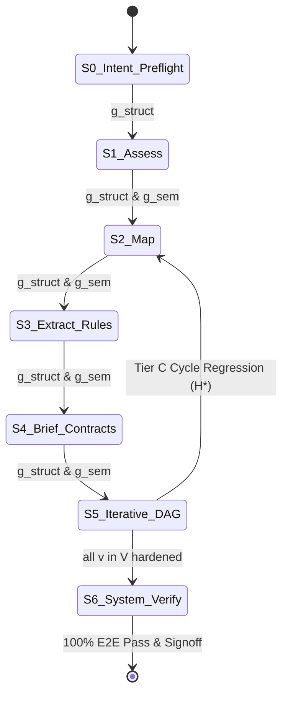
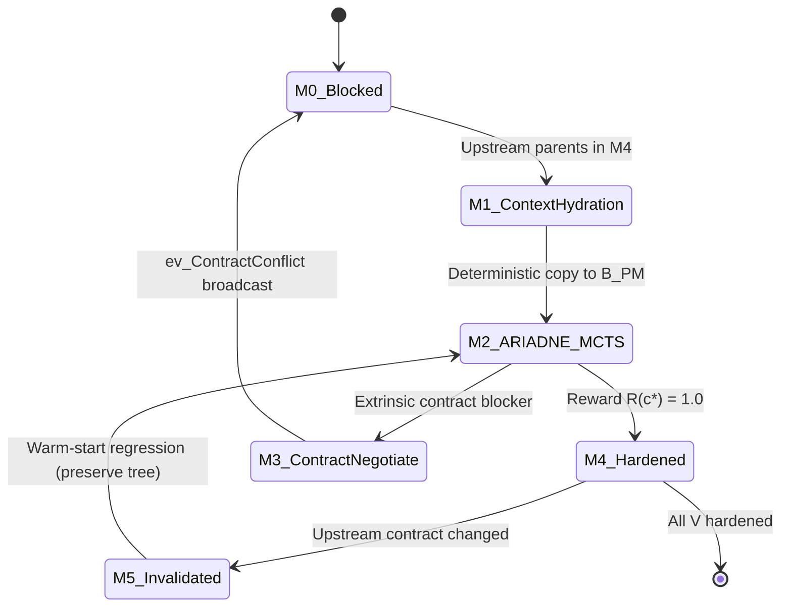

# Technical Specification: werðan Code Modernization Multi-Agent Architecture

## 1. Executive Summary & Architectural Authority

This technical specification establishes the formal architecture, module contracts, interfaces, data layouts, and system invariants for `werðan`.

### Authoritative Reference
Per **ADR 0005** (`docs/decisions/0005-methodology-source-of-truth.md`) and project architectural governance, the inviolable mathematical and architectural ground truth of this system is:

> **[`docs/references/METHODOLOGY.md`](../references/METHODOLOGY.md)**  
> *(supplemented by foundational derivations in [`docs/references/METHODOLOGY-DRV.md`](../references/METHODOLOGY-DRV.md))*

All module implementations, agent definitions, statechart lifecycles, and verification protocols derive from and are governed by `METHODOLOGY.md`. In case of any ambiguity or conflict between implementation notes and `METHODOLOGY.md`, `METHODOLOGY.md` strictly supersedes. In accordance with architectural governance directives, the system methodology has no arbitrary commercial or brand names; it is formally defined as the **Two-Tier Harel Statechart and Encapsulated ARIADNE Multi-Agent Architecture for Repository-Scale Code Modernization**.

### Primary System Objectives
During every modernization campaign across a legacy codebase $\mathcal{R}_{\text{leg}}$ in source language $\mathcal{L}_{\text{src}}$ producing target repository $\mathcal{R}_{\text{tgt}}$ in target language $\mathcal{L}_{\text{tgt}}$ under execution harness $\mathcal{H}_{\text{exec}}$, the system strictly maximizes and satisfies three formal criteria:
1. **Syntactic and Type-Level Compilation**: $\mathbb{I}_{\text{compile}}(\mathcal{R}_{\text{tgt}}) = 1.0$ across all inter-module boundaries without warnings or stub placeholders.
2. **Behavioral Parity Across Domain Invariants**: $\text{PassRate}_{\text{char}}(\mathcal{R}_{\text{tgt}}) = 1.0$ across all extracted business rules, property-based tests, and characterization test suites.
3. **Architectural Idiomaticity and Static Security**: $\text{Score}_{\text{harden}}(\mathcal{R}_{\text{tgt}}) = 1.0$ across static security analyzers, vulnerability audits, and idiomatic target guidelines, while minimizing execution wall-clock time via maximal topological wave parallelism and warm-started state caches.

---

## 2. Architectural Design Decisions and Theoretical Justifications

Repository-scale modernization violates the assumptions of standard conversational multi-agent workflows because legacy codebases exhibit **non-monotonic discovery**: implementation faults uncovered late in module translation frequently invalidate earlier assumptions regarding interface contracts or dependency topologies. Every structural choice in this architecture resolves a specific failure mode of existing multi-agent paradigms:

### 2.1 Decoupling Deterministic Control Topology from Bounded Reasoning Context
- **Failure Mode**: In manager-worker systems (e.g. GVS5H) and conversational hierarchies, an LLM orchestrator maintains workflow state in its prompt history and decides agent transitions via token generation. Over long horizons, this induces *state hallucination* and *context window saturation*, particularly in Small Language Models (SLMs).
- **Design Decision**: Partition the Macro-Orchestrator $\mathcal{O} = (\mathcal{O}_{\text{engine}}, \mathcal{O}_{\text{arbiter}})$ into a **deterministic statechart runtime engine** ($\mathcal{O}_{\text{engine}}$, programmatic Rust control code) and an on-demand, stateless **LLM Arbiter** ($\mathcal{O}_{\text{arbiter}}$) invoked exclusively for semantic ambiguity triage. All worker agents are **stateless, ephemeral functions** that never poll or maintain persistent daemon sessions; they are instantiated on demand via push-based context hydration from $\mathcal{O}_{\text{engine}}$ and terminate immediately upon committing artifacts.

### 2.2 Harel Statecharts over Flat FSMs and Static Pipelines
- **Failure Mode**: Static feed-forward pipelines (e.g. ReCodeAgent) lack backward topological edges to recover when downstream validation invalidates upstream plans. Conversely, placing a flat Finite State Machine (FSM) at the root of an agent hierarchy forces lockstep global phase rollbacks: tracking $|V|$ modules across $m$ module states requires $O(m^{|V|})$ composite states.
- **Design Decision**: Formalize control via a **Harel Statechart** $\mathcal{H}$ combining **XOR Macro-Superstates** (for repository-wide phases), **Orthogonal `AND`-Regions** (reducing module state complexity from $O(m^{|V|})$ to $O(m \cdot |V|)$), **Broadcast Event Calculus** (for surgical $O(1)$-hop cross-module regressions), and **Deep History ($H^*$)** (preserving verified modules across macro-regressions).

### 2.3 Declarative Scatter-Gather ($D_{\max}=1$) over Autonomous Recursive Subagent Spawning
- **Failure Mode**: In large enterprise repositories (500+ files, 250k+ lines of code), global discovery phases (inventory, rule mining, contract stubbing) exceed single-agent context limits. However, granting LLM agents an autonomous `spawn_subagent` tool inside a ReAct loop introduces three fatal failure modes:
  1. *Parent Context Implosion*: If a parent agent spawns $K$ subagents and receives their outputs back into its conversation history, the parent's context window overflows ($O(K \times \text{output\_size})$).
  2. *Shadow State Outside Blackboard*: Execution state lives in the parent's transient message buffer rather than in $\Sigma(\mathcal{G})$, destroying deterministic checkpointing and $H^*$ recovery.
  3. *Unbounded Recursion & Cost*: Confused agents trigger runaway agent trees (Manager $\to$ Sub-Manager $\to$ Worker), re-introducing context drift and token exhaustion.
- **Design Decision**: Non-ARIADNE agents are strictly prohibited from imperative subagent spawning. Instead, parallelizable macro-phases execute as deterministic 3-stage sub-statecharts (**`Scatter` $\to$ `Parallel Map` $\to$ `Reduce`**) managed by $\mathcal{O}_{\text{engine}}$ over partitioned blackboard slices, enforcing a strict recursion depth invariant of $D_{\max} = 1$:
  - *Out-of-Shard Definitions*: Resolved via zero-LLM deterministic LSP tools (`go_to_definition`, `find_references`, AST symbol body lookup) or declarative `UnresolvedCrossLink(src_id, tgt_symbol)` tags stitched during `Reduce`, avoiding recursive spawning.
  - *Phase-by-Phase Subagent Policy*:

| Macro-Phase / Component | Needs Subagent Fan-Out? | Exact Scatter $\to$ Map $\to$ Reduce Mechanics on $\mathcal{G}$ |
| :--- | :--- | :--- |
| **$S_0$ Intent & Preflight** | No (Single Agent) | `PreflightProbe` runs deterministic build/test commands; writes harness config and `INTENT` to $\mathcal{G}$. |
| **$S_1$ Assess** | Yes (Directory Shards) | **Scatter**: AST/scc scanner groups repo into directory shards.<br>**Map**: Parallel `ShardAssessor` agents analyze dialects and debt per shard.<br>**Reduce**: `AssessmentSynthesizer` aggregates shard reports into risk matrix. |
| **$S_2$ Map (DAG)** | Hybrid (Static Tool + Targeted Map) | **Scatter**: LSP/Tree-sitter builds explicit call/import graph; flags dynamic files.<br>**Map**: Parallel `ImplicitCouplingScanner` agents inspect flagged files for hidden edges.<br>**Reduce**: Tarjan SCC condensation yields DAG $G=(V,E)$. |
| **$S_3$ Extract Rules** | Yes (DAG Vertex Shards) | **Scatter**: $\mathcal{O}_{\text{engine}}$ partitions $V$ into bounded vertex batches.<br>**Map**: Parallel `RuleMiner` agents extract `Given/When/Then` cards directly to $\mathcal{G}$.<br>**Reduce**: `CrossModuleRuleLinker` resolves `UnresolvedCrossLink` markers across edges. |
| **$S_4$ Brief & Contracts** | Yes (Domain Subgraphs) | **Scatter**: `MacroArchitect` sets global target idioms on $\mathcal{G}$.<br>**Map**: Parallel `ContractStubber` agents generate target interface stubs for $e_{pi} \in E$.<br>**Reduce**: Target compiler verifies that all interface stubs mutually type-check. |
| **$S_5$ Iterative DAG** | Yes (Topological Waves) | Kahn wave dispatch spawns parallel encapsulated ARIADNE clusters over $\text{ReadySet}(\mathcal{G})$. |
| **$S_6$ Verify & Harden** | Yes (Test & SAST Shards) | Parallel `IntegrationVerifier` and `SecurityAuditor` agents dispatched per failing E2E trace or SAST finding. |
| **Stage 2 Critics ($g_{\text{sem}}$)** | Yes (Batch-Sharded Auditing) | $\mathcal{O}_{\text{engine}}$ fans out parallel `ShardCritic` agents (10–15 rule cards or contracts per shard); conjuncts $\bigwedge_{b=1}^B g_{\text{sem}}(\text{batch}_b)$. |

### 2.4 Two-Stage Hybrid Phase Guards ($g = g_{\text{struct}} \land g_{\text{sem}}$)
- **Failure Mode**: Purely programmatic guards (schema validation, AST parsing, DAG acyclicity) are syntactically sound but semantically shallow—they cannot detect omitted business rules or over-engineered interfaces. Conversely, evaluating transitions purely via an LLM critic wastes tokens on structurally malformed outputs.
- **Design Decision**: Every phase transition is gated by a short-circuiting conjunction of a zero-token **Deterministic Structural Guard** ($g_{\text{struct}}$) followed conditionally by a sharded, read-isolated **Adversarial Semantic Guard** ($g_{\text{sem}}$) whose typed boolean verdict drives $\mathcal{O}_{\text{engine}}$ deterministically.

### 2.5 Encapsulated Intra-Module MCTS Solvers (ARIADNE Sub-Holons)
- **Failure Mode**: Single-trajectory translators patch a single code draft linearly, degenerating into local repair loops when the initial refactoring strategy is flawed. However, running Monte Carlo Tree Search (MCTS) globally across an entire repository causes an $O(|V| \times |\mathcal{A}|)$ action-space explosion.
- **Design Decision**: Encapsulate **ARIADNE** (a Softmax-UCB MCTS planner coupled with a 4-slice local blackboard and a 5-component specialist pool) as an isolated intra-module solver node (`M2`) instantiated per DAG vertex $v_i \in V$. Furthermore, elevate **Business Rule Extraction** to a pre-DAG global phase ($S_3$) so cross-cutting domain invariants are locked before target interface design ($S_4$).

### 2.6 Push-Based Ephemeral Invocation & Zero-Polling Invariant
- **Failure Mode**: Having LLM agents run as persistent daemons continuously watching or polling a blackboard wastes process memory, saturates token budgets, and introduces race conditions.
- **Design Decision**: All non-$\mathcal{O}$ agents are stateless, ephemeral worker functions. They never poll or watch $\mathcal{G}$. Only $\mathcal{O}_{\text{engine}}$ maintains an active event-loop listener over $\mathcal{Q}_{\text{events}}$. Workers commit artifacts directly to their assigned blackboard partition on $\mathcal{G}$, push a typed completion event `ev_TaskDone` to $\mathcal{Q}_{\text{events}}$, and terminate immediately.

---

## 3. Workspace Crate Layout & Architectural Hierarchy

The codebase is organized as a strict hierarchical Cargo workspace rooted at `werðan/`, enforcing High Cohesion and Loose Coupling:

```text
werðan/
├── bins/                           # Execution Frontends
│   ├── interactive/                # Oh-My-Pi (OMP) Ratatui TUI cockpit (60/40 layout, CSI-2026)
│   └── daemon/                     # Headless batch CLI runner with dual-sink structured tracing
│
├── topology/                       # Orchestration & Multi-Agent Topology Layer
│   ├── operative/                  # Atomic agent blueprints, ReAct tool execution loops, stream emitters
│   ├── cluster/                    # Multi-operative ensembles & encapsulated ARIADNE MCTS search nodes
│   └── topology/                   # Turnkey runtime engine, Kahn's wave scheduler, event bus
│
└── infras/                         # Foundational Infrastructure & Domain Capabilities
    ├── core/                       # Shared protocol schemas, ModernizeConfig, PaneRole, wire events
    ├── blackboard/                 # Global Blackboard (G) and per-module 4-slice Local Blackboard (B)
    ├── statechart/                 # Deterministic Harel Statechart (S0..S6) and Micro-FSM (M0..M5)
    ├── laya/                       # Fast local System-1 model (guardrail, UCB action priors, JEV judge)
    └── tools/
        ├── mcp/                    # Filesystem sandbox, tree-sitter/LSP, compiler runner, test harness
        └── rea/                    # Reverse Engineering Assistant (binary CFG/DFG, ABI recovery)
```

---

## 4. Formal Data Layouts & Blackboard Schemas

The system operates across a two-tier blackboard architecture separating repository-wide state from module-scoped exploration.

### 4.1 Definition 1: Global Repository Blackboard ($\mathcal{G}$) and State Vector $\Sigma(\mathcal{G})$

The Global Blackboard $\mathcal{G}$ is a persistent, schema-validated tuple:

$$\mathcal{G} = \Big\langle \mathcal{I}_{\text{inv}}, \; G=(V,E), \; \mathcal{R}_{\text{rules}}, \; \mathcal{C}_{\text{contracts}}, \; \mathcal{A}_{\text{artifacts}}, \; \Sigma(\mathcal{G}) \Big\rangle$$

| Component | Type | Description |
| :--- | :--- | :--- |
| $\mathcal{I}_{\text{inv}}$ | `InventoryManifest` | Repository file inventory, dialect profile, and verified build/test harness configuration. |
| $G = (V,E)$ | `CondensedDAG` | Condensed Dependency Directed Acyclic Graph where vertices $v_i \in V$ represent atomic translation units (or collapsed SCCs) and directed edges $e_{pi} = (v_p, v_i) \in E$ represent dependency obligations. |
| $\mathcal{R}_{\text{rules}}$ | $V \to 2^{\text{RuleCard}}$ | Verified `Given/When/Then` business rule cards with exact `legacy_file:line` source citations. |
| $\mathcal{C}_{\text{contracts}}$ | $E \to \text{InterfaceSpec}$ | Target-language type signatures, API contracts, and behavioral preconditions across dependency edges. |
| $\mathcal{A}_{\text{artifacts}}$ | $V \to (\text{TargetAST} \times \text{TestSuite})$ | Final hardened target modules and their passing characterization test suites. |
| $\Sigma(\mathcal{G})$ | `GlobalStateVector` | Transactionally persisted runtime state: $\langle S_{\text{macro}}, \mathbf{M}, \Theta_{H^*}, \mathcal{Q}_{\text{events}} \rangle$. |

The persisted runtime state vector is formalized as:

$$\Sigma(\mathcal{G}) = \Big\langle S_{\text{macro}}, \; \mathbf{M} = \big[M(v_1), \dots, M(v_{|V|})\big], \; \Theta_{H^*}, \; \mathcal{Q}_{\text{events}} \Big\rangle$$

comprising the active macro-state $S_{\text{macro}}$, the vector of per-module micro-states $\mathbf{M}$, the deep-history snapshot map $\Theta_{H^*}$, and the FIFO asynchronous event bus $\mathcal{Q}_{\text{events}}$.

### 4.2 Definition 2: Per-Module 4-Slice Local Blackboard ($\mathcal{B}^{(v_i)}$)

Each active module vertex $v_i \in V$ owns an isolated **Local Blackboard** $\mathcal{B}^{(v_i)}$ invisible to other vertices:

$$\mathcal{B}^{(v_i)} = \Big( \mathcal{B}_{PM}^{(v_i)}, \; \mathcal{B}_{SH}^{(v_i)}, \; \mathcal{B}_{CT}^{(v_i)}, \; \mathcal{B}_{PR}^{(v_i)} \Big)$$

1. **Problem Model ($\mathcal{B}_{PM}^{(v_i)}$)**: Hydrated deterministically from $\mathcal{G}$ upon module activation with legacy AST slices, verified rule cards $\mathcal{R}_{\text{rules}}(v_i)$, upstream parent contracts $\{\mathcal{C}_{\text{contracts}}(v_p, v_i)\}$, and downstream export obligations.
2. **Strategy Hypotheses ($\mathcal{B}_{SH}^{(v_i)}$)**: Competing refactoring strategies $h_k$ (e.g. direct structural port vs. state-pattern decomposition) with prior utility estimates $P_{\text{prior}}$ from Laya.
3. **Counterexamples & Characterization Tests ($\mathcal{B}_{CT}^{(v_i)}$)**: Black-box I/O fixtures, property-based tests, and falsifying test inputs derived from legacy behavior.
4. **Patch & Fault Records ($\mathcal{B}_{PR}^{(v_i)}$)**: Distilled compiler diagnostics, test failure traces, and root-cause fault localizations indexing failed rollouts.

### 4.3 Definition 3: Formal Harel Statechart 7-Tuple ($\mathcal{H}$)

Control flow in $\mathcal{O}_{\text{engine}}$ is governed by the Harel Statechart tuple:

$$\mathcal{H} = \Big( \mathcal{S}, \; \rho, \; \psi, \; \mathcal{E}_{\text{bus}}, \; \mathcal{G}_{\text{guards}}, \; \mathcal{T}_{\text{trans}}, \; \Theta_{H^*} \Big)$$

- **Hierarchy Function ($\rho: \mathcal{S} \to 2^{\mathcal{S}}$)**: Top-level root state decomposes into seven sequential XOR Macro-States: $\rho(\text{Root}) = \{S_0, S_1, S_2, S_3, S_4, S_5, S_6\}$.
- **Orthogonality Function ($\psi: \mathcal{S} \to \{\texttt{XOR}, \texttt{AND}\}$)**:
  - For parallel discovery states $S_m \in \{S_1, S_2, S_3, S_4, S_6\}$, substate $S_m.2$ has $\psi(S_m.2) = \texttt{AND}$ over $K$ stateless workers: $S_m.2 = \bigparallel_{k=1}^K W(\text{shard}_k)$.
  - For DAG Transformation state $S_5$, $\psi(S_5) = \texttt{AND}$ over $|V|$ concurrent module regions:
    $$S_5 = R(v_1) \;\parallel\; R(v_2) \;\parallel\; \dots \;\parallel\; R(v_{|V|})$$
    where each orthogonal region $R(v_i)$ executes an isomorphic 6-state Micro-FSM: $\rho(R(v_i)) = \{\texttt{M0}, \texttt{M1}, \texttt{M2}, \texttt{M3}, \texttt{M4}, \texttt{M5}\}$.
- **Guarded Broadcast Transition Relation ($\mathcal{T}_{\text{trans}}$)**: Every transition takes the canonical form:
  $$s_{\text{src}} \xrightarrow{\; \text{ev} \; [g(\mathcal{G})] \; / \; \alpha(\mathcal{G}) \;} s_{\text{dst}}$$
  where $\text{ev} \in \mathcal{E}_{\text{bus}}$ is popped from $\mathcal{Q}_{\text{events}}$, $g(\mathcal{G})$ is the short-circuiting guard predicate, and $\alpha(\mathcal{G})$ is the transition action.
- **Deep History Pseudostate ($\Theta_{H^*}$)**: Upon any macro-regression exiting $S_5$ to an earlier state $S_m$ ($m \in \{2, 3, 4\}$), $\mathcal{O}_{\text{engine}}$ records $\Theta_{H^*}(S_5) \leftarrow \mathbf{M}$. Upon re-entering $S_5$ via the $H^*$ connector, every unaffected region $R(v_i)$ is restored directly to its prior state $M(v_i)$, preserving verified `M4_Hardened` modules without re-execution.

### 4.4 Definition 4: Dynamic Context Hydration via `TaskActivationEnvelope`

Every transition action $\alpha(\mathcal{G})$ invokes a deterministic **`ContextAssembler`** function:

$$\text{Hydrate}\big(\text{AgentRole}, \; \mu_{\text{mode}}, \; \text{target\_ref}, \; \mathcal{G}\big) \longrightarrow \mathcal{E}_{\text{act}} = \Big\langle \mu_{\text{mode}}, \; \mathcal{G}_{\text{slice}}, \; \Delta_{\text{directive}}, \; \mathcal{T}_{\text{tools}} \Big\rangle$$

where $\mu_{\text{mode}} \in \{\texttt{INITIAL}, \texttt{CRITIC\_RETRY}, \texttt{WARM\_START\_REGRESSION}\}$ selects the system prompt template, $\mathcal{G}_{\text{slice}}$ queries only the bounded 1-hop subgraph relevant to `target_ref`, $\Delta_{\text{directive}}$ injects the failure critique or contract conflict trace, and $\mathcal{T}_{\text{tools}}$ binds read-only deterministic AST/LSP navigation tools.

---

## 5. Macro-Level Orchestration: The 7-Phase Pipeline & Two-Stage Guards

### 5.1 Macro-Statechart Topology ($S_0 \dots S_6$)



| State | Phase Name | Scatter-Gather Topology ($S_m.1 \to S_m.3$) | Structural Guard ($g_{\text{struct}}$) | Adversarial Semantic Guard ($g_{\text{sem}}$) |
| :--- | :--- | :--- | :--- | :--- |
| **$S_0$** | **Intent & Preflight** | Single `PreflightProbe` agent (no sharding). | Legacy build compiles; baseline test harness executes; `INTENT` schema valid. | N/A (Empirical execution gate). |
| **$S_1$** | **Assess** | **Scatter**: Directory shards.<br>**Map**: `ShardAssessor` (dialect, debt).<br>**Reduce**: `AssessmentSynthesizer`. | 100% file inventory coverage against `scc`/`cloc`; valid metric ranges. | `AssessmentCritic` verifies every risk claim cites valid legacy files; flags unmapped dialects. |
| **$S_2$** | **Map (DAG)** | **Scatter**: Static LSP/Tree-sitter builds graph & flags dynamic files.<br>**Map**: `ImplicitCouplingScanner` on flagged files.<br>**Reduce**: Tarjan SCC condensation into DAG $G=(V,E)$. | $G=(V,E)$ is strictly acyclic; all entry points and files belong to exactly one $v_i \in V$. | `TopologyCritic` audits flagged reflection, shared DB tables, and event buses for missed implicit edges. |
| **$S_3$** | **Extract Rules** | **Scatter**: Vertex batches from $V$.<br>**Map**: `RuleMiner` extracts `Given/When/Then` cards.<br>**Reduce**: `CrossModuleRuleLinker` resolves cross-vertex rules. | Every rule card contains valid `Given/When/Then` clauses, `legacy/file:line` pointers, and `Observed` vs. `Inferred` tags. | `RuleAuditor` (independent agent) re-verifies every rule card against legacy AST snippets for completeness and hallucination. |
| **$S_4$** | **Brief & Contracts** | **Scatter**: `MacroArchitect` sets global idioms; edges $E$ sharded by domain.<br>**Map**: `ContractStubber` writes interface stubs.<br>**Reduce**: Target compiler checks stub compatibility. | Every edge $e_{pi} \in E$ has a compilable target interface stub in $\mathcal{C}_{\text{contracts}}$. | `ArchitectureCritic` audits target interfaces against $\mathcal{R}_{\text{rules}}$ to prevent over-engineering or unrepresentable domain invariants. |
| **$S_5$** | **Iterative DAG** | **Composite AND-State**: Topological Wave Scheduler over $R(v_1) \parallel \dots \parallel R(v_{|V|})$ running encapsulated ARIADNE clusters. | $\forall v_i \in V, M(v_i) = \texttt{M4\_Hardened}$ with composite reward $R(c_i^\star) = 1.0$. | Enforced intra-cluster via $\mathcal{A}_{\text{eval}}^{\text{distill}}$ rule-parity verification prior to entering `M4`. |
| **$S_6$** | **System Verify** | **Scatter**: E2E test suites & SAST scanners.<br>**Map**: `IntegrationVerifier` & `SecurityAuditor`.<br>**Reduce**: Final parity sign-off generator. | 100% E2E integration test pass rate; zero critical SAST/CVE vulnerabilities. | `ReleaseAuditor` verifies end-to-end compliance with `INTENT` and signs off per-module verdicts. |

### 5.2 Two-Stage Guard Verification Formulation

Before transitioning out of phase $S_m$, $\mathcal{O}_{\text{engine}}$ evaluates:

$$g(\mathcal{G}) = \underbrace{\Big( \bigwedge_{k=1}^K g_{\text{struct}}\big(\mathcal{G}[\text{shard}_k]\big) \Big)}_{\text{Stage 1: Zero-Token Programmatic Check}} \;\land\; \underbrace{\Big( \bigwedge_{b=1}^{B} g_{\text{sem}}\big(\mathcal{G}[\text{batch}_b]\big) \Big)}_{\text{Stage 2: Sharded Adversarial LLM Critic}}$$

If Stage 1 fails on $\text{shard}_k$, $\mathcal{O}_{\text{engine}}$ immediately re-dispatches only $W_k$ with `ActivationMode = CRITIC_RETRY` and the deterministic traceback. Only when Stage 1 passes across all shards does $\mathcal{O}_{\text{engine}}$ fan out Stage 2: parallel, read-isolated `ShardCritic` agents that audit batches of produced artifacts against legacy `file:line` source citations and return a structured `CritiqueRecord`:

```json
{
  "verdict": "PASS" | "REJECT_LOCAL" | "REGRESS_UPSTREAM",
  "violated_invariants": ["..."],
  "remediation_directive": "..."
}
```

---

## 6. Topological Wave Scheduling & Encapsulated ARIADNE MCTS Nodes

### 6.1 Per-Module Micro-FSM ($\mathcal{M}_{v_i}$)

Each orthogonal region $R(v_i)$ transitions through six micro-states:



- **`M0_Blocked`**: Waiting for upstream parents $\{v_p \mid (v_p, v_i) \in E\}$ to reach `M4_Hardened`.
- **`M1_ContextHydration` (Deterministic, Non-LLM)**: Triggered when $v_i \in \text{ReadySet}(\mathcal{G})$. Deterministically copies $\mathcal{R}_{\text{rules}}(v_i)$ and parent contracts $\{\mathcal{C}_{\text{contracts}}(v_p, v_i)\}$ from $\mathcal{G}$ into $\mathcal{B}_{PM}^{(v_i)}$ and transitions immediately to `M2`.
- **`M2_ARIADNE_MCTS`**: Executes the encapsulated ARIADNE cluster. Transitions to `M4_Hardened` if candidate $c^\star$ achieves $R(c^\star) = 1.0$; transitions to `M3_ContractNegotiate` if an extrinsic upstream contract conflict is proved; or emits a Tier C macro-regression if an undiscovered dependency cycle is found.
- **`M3_ContractNegotiate`**: Emits broadcast event `ev_ContractConflict(v_p, v_i, \Delta_{\text{spec}}, \text{trace})` to $\mathcal{Q}_{\text{events}}$ on $\mathcal{G}$ and parks $v_i$ back in `M0_Blocked`.
- **`M4_Hardened`**: Commits verified target code $c^\star$ and characterization test suite $\mathcal{B}_{CT}^{(v_i)}$ to $\mathcal{A}_{\text{artifacts}}(v_i)$ on $\mathcal{G}$ and emits `ev_ModuleHardened(v_i)`, triggering $\mathcal{O}_{\text{engine}}$ to recompute $\text{ReadySet}(\mathcal{G})$.
- **`M5_Invalidated` (Warm-Start Regression State)**: Entered when a `M4_Hardened` module receives a validated `ev_ContractConflict` from a downstream child (or when its own parent updates an interface). Deterministically appends $\Delta_{\text{spec}}$ to $\mathcal{B}_{PM}^{(v_i)}$ while preserving the existing MCTS search tree $\mathcal{T}^{(v_i)}$, strategy hypotheses $\mathcal{B}_{SH}^{(v_i)}$, and test suite $\mathcal{B}_{CT}^{(v_i)}$, then transitions back to `M2_ARIADNE_MCTS`.

### 6.2 Topological Wave Dispatch (Kahn's Algorithm)

Upon entering $S_5$, $\mathcal{O}_{\text{engine}}$ executes Kahn's algorithm over $G=(V,E)$ in $\mathcal{G}$ to continuously evaluate the set of unblocked vertices:

$$\text{ReadySet}(\mathcal{G}) = \Big\{ v_i \in V \;\Big\vert{}\; M(v_i) = \texttt{M0\_Blocked} \;\land\; \forall (v_p, v_i) \in E, \; M(v_p) = \texttt{M4\_Hardened} \Big\}$$

For every vertex $v_i \in \text{ReadySet}(\mathcal{G})$, $\mathcal{O}_{\text{engine}}$ activates an orthogonal region $R(v_i)$ running an isolated ARIADNE cluster.

### 6.3 Deterministic MCTS Controller ($\mathcal{C}_{\text{MCTS}}^{(v_i)}$)

The controller is deterministic algorithmic code (non-LLM) maintaining search tree $\mathcal{T}^{(v_i)}$ where nodes $u$ represent states $s_t = (c_t, \mathcal{B}_t^{(v_i)})$. Rollout traversal samples child states via temperature-controlled Softmax-UCB:

$$\text{UCB}(u) = \bar{R}(u) + C_{\text{exp}} \sqrt{\frac{\ln(N(v) + 1)}{N(u)}} + \gamma \cdot P_{\text{prior}}(u)$$

$$p(u \mid v) = \frac{\exp\big((\text{UCB}(u) - \max_{w} \text{UCB}(w)) / \tau\big)}{\sum_{w \in \text{Children}(v)} \exp\big((\text{UCB}(w) - \max_{w'} \text{UCB}(w')) / \tau\big)}$$

Constants: $C_{\text{exp}} = 1.414$, $\tau = 0.35$, $\gamma = 0.15$.

### 6.4 Ephemeral Generative Subagents (Strict Read/Write Isolation)

- **$\mathcal{A}_{\text{str}}$ (Strategy Analysis — LLM)**: Invoked when node $u$ lacks unexpanded strategies; reads $\mathcal{B}_{PM}^{(v_i)}$ and writes $K_s$ refactoring hypotheses with prior scores $P_{\text{prior}}$ to $\mathcal{B}_{SH}^{(v_i)}$.
- **$\mathcal{A}_{\text{gen}}$ (Code Generation — LLM)**: Invoked on uninstantiated strategy $h \in \mathcal{B}_{SH}^{(v_i)}$; synthesizes candidate target code $c'$ conforming to $\mathcal{B}_{PM}^{(v_i)}$.
- **$\mathcal{A}_{\text{test}}$ (Adversarial Test Generation — LLM)**: Reads $\mathcal{B}_{PM}^{(v_i)}$ and legacy reference behavior. **Strictly read-isolated from candidate code $c'$** to prevent test weakening or cheat fitting. Generates characterization I/O snapshots and property tests into $\mathcal{B}_{CT}^{(v_i)}$.
- **$\mathcal{A}_{\text{patch}}$ (Surgical Code Repair — LLM)**: Invoked when $c_t$ fails verification ($0 < R(s_t) < 1$); reads $c_t$ and the localized fault record in $\mathcal{B}_{PR}^{(v_i)}$ to emit minimal diff patch $c''$.

### 6.5 Two-Stage Hybrid Evaluator ($\mathcal{A}_{\text{eval}} = \mathcal{A}_{\text{eval}}^{\text{exec}} \circ \mathcal{A}_{\text{eval}}^{\text{distill}}$)

1. **Stage 3a — Deterministic Verification Harness ($\mathcal{A}_{\text{eval}}^{\text{exec}}$, Non-LLM)**: Compiles $c'$ against parent artifacts, runs LSP type-checking, executes characterization tests $\mathcal{B}_{CT}^{(v_i)}$ via differential test runners, and runs static security linters.
2. **Stage 3b — Diagnostic Distiller & Parity Critic ($\mathcal{A}_{\text{eval}}^{\text{distill}}$, Lightweight LLM)**:
   - *On Failure*: Distills raw compiler/test stack traces into a localized fault record in $\mathcal{B}_{PR}^{(v_i)}$ and classifies fault cause $\kappa \in \{\texttt{INTRINSIC}, \texttt{EXTRINSIC\_CONTRACT}, \texttt{EXTRINSIC\_CYCLE}\}$.
   - *On Pass*: Audits $c'$ against all `Given/When/Then` rule cards in $\mathcal{B}_{PM}^{(v_i)}$ to compute semantic parity score $\text{Score}_{\text{harden}}(c') \in [0, 1]$.

### 6.6 Gated Hierarchical Reward Function $R(s_t)$

$$R(s_t) = w_{\text{comp}} \cdot \mathbb{I}_{\text{compile}}(c_t) + \mathbb{I}_{\text{compile}}(c_t) \cdot \Big[ w_{\text{char}} \cdot \text{PassRate}_{\text{char}}\big(c_t, \mathcal{B}_{CT}^{(v_i)}\big) + w_{\text{hard}} \cdot \text{Score}_{\text{harden}}\big(c_t, \mathcal{B}_{PM}^{(v_i)}\big) \Big]$$

Default weights: $w_{\text{comp}} = 0.20$, $w_{\text{char}} = 0.60$, $w_{\text{hard}} = 0.20$ ($w_{\text{comp}} + w_{\text{char}} + w_{\text{hard}} = 1.0$).
Uncompilable code strictly receives $R(s_t) = 0.0$. Achieving $R(s_t) = 1.0$ is the necessary and sufficient condition for module hardening.

---

## 7. Multi-Tier Regression Calculus and Warm-Start Recovery

Discovered anomalies are classified and resolved across three strict locality tiers:

| Tier | Fault Class ($\kappa$) | Scope & Traffic | Action & Recovery Protocol |
| :--- | :--- | :--- | :--- |
| **Tier A** | `INTRINSIC` | Intra-module only (Zero global traffic) | Handled entirely inside $\mathcal{C}_{\text{MCTS}}^{(v_i)}$: $R(s_t) < 1.0$ is backpropagated up $\mathcal{T}^{(v_i)}$, shifting subsequent rollouts to $\mathcal{A}_{\text{patch}}$ using $\mathcal{B}_{PR}^{(v_i)}$ or branching to an alternate hypothesis in $\mathcal{B}_{SH}^{(v_i)}$. Macro-orchestrator $\mathcal{O}$ is never interrupted. |
| **Tier B** | `EXTRINSIC_CONTRACT` | Cross-module 1-hop via broadcast event bus | Downstream $v_i$ transitions $\texttt{M2} \to \texttt{M3}$ and broadcasts `ev_ContractConflict(v_p, v_i, \Delta_{\text{spec}}, \text{trace})`. $\mathcal{O}_{\text{engine}}$ verifies symbol reference and $\mathcal{O}_{\text{arbiter}}$ confirms validity. $\mathcal{O}_{\text{engine}}$ updates $\mathcal{C}_{\text{contracts}}$, parks $v_i \to \texttt{M0}$, and invalidates parent $v_p \to \texttt{M5\_Invalidated} \to \texttt{M2}$ with warm-started tree. |
| **Tier C** | `EXTRINSIC_CYCLE` | Repository-wide macro-regression with Deep History ($H^*$) | Emits `ev_CyclicDependencyFound`. $\mathcal{O}_{\text{engine}}$ checkpoints module state vector $\Theta_{H^*}(S_5) \leftarrow \mathbf{M}$, transitions $S_5 \to S_2$, condenses cyclic vertices via Tarjan's SCC into composite unit $v_{\text{SCC}}$, updates rules ($S_3$) and stubs ($S_4$), and re-enters $S_5$ via $H^*$, restoring unaffected modules without re-execution. |

---

## 8. Formal Execution Algorithms

### 8.1 Algorithm 1: Deterministic Macro-Statechart Engine ($\mathcal{O}_{\text{engine}}$) & Declarative Scatter-Gather

```text
Input: Legacy Repository R_leg, Target Spec L_tgt, Execution Harness H_exec
Output: Hardened Target Repository R_tgt stored in A_artifacts on G

1. Initialize Global Blackboard G <- empty, State Vector Sigma(G) <- <S_macro = S0, M = [], Theta_H* = empty, Q_events = [ev_Start]>.
2. While S_macro != TERMINATED do:
   If S_macro in {S0, S1, S2, S3, S4, S6} (Global Discovery, Specification & Verification Phases) then:
     Substate S_m.1 (Scatter): Partition phase workload into bounded shards {shard_1, ..., shard_K}
       with Tokens(shard_k) <= L_max and write WorkManifest to G.
     Substate S_m.2 (Parallel Map): For each k in {1, ..., K} in parallel, construct envelope
       E_act^(k) <- Hydrate(MapAgent(S_macro), INITIAL, shard_k, G) and invoke stateless worker W_k(E_act^(k)),
       which writes output directly to G[shard_k] and terminates.
     Substate S_m.3 (Reduce): Invoke Cross-Shard Linker over boundary headers and UnresolvedCrossLink tags in G[shard_1..K].
     Stage-1 Structural Guard:
       For each k in {1, ..., K} where g_struct(G[shard_k]) == False:
         Re-hydrate E_act^(k) with mu_mode = CRITIC_RETRY and validator traceback; re-invoke W_k until g_struct passes.
     Stage-2 Adversarial Semantic Guard:
       Fan out read-isolated ShardCritic subagents across artifact batches b in {1, ..., B}.
       If exists b such that g_sem(G[batch_b]) == REJECT_LOCAL then:
         Re-hydrate and re-invoke only offending shard workers with DeltaDirective set to Critic's CritiqueRecord; continue loop.
       Else if exists b such that g_sem(G[batch_b]) == REGRESS_UPSTREAM then:
         Transition S_macro to target upstream state S_target; continue loop.
     Advance Phase: If S_macro == S4, initialize M[v_i] <- Theta_H*(S5)[v_i] (if v_i in Theta_H*) else M0_Blocked for all v_i in V.
       Transition S_macro <- NextState(S_macro).

   Else if S_macro == S5 (Composite Orthogonal State: Iterative DAG Transformation) then:
     Topological Wave Dispatch: Compute ReadySet(G) = {v_i in V | M(v_i) == M0_Blocked and forall (v_p, v_i) in E, M(v_p) == M4_Hardened}.
     For each v_i in ReadySet(G) in parallel do:
       State M1: Deterministically copy R_rules(v_i) and parent contracts {C_contracts(v_p, v_i)} from G into B_PM^(v_i).
       State M2: Transition M(v_i) <- M2_ARIADNE_MCTS and execute Algorithm 2 (ARIADNE_Cluster(v_i, B^(v_i), G)).
     Event Bus Processing: Pop next event ev <- Q_events.pop():
       Case ev == ev_ModuleHardened(v_i, c_i*, B_CT^(v_i)):
         Commit (c_i*, B_CT^(v_i)) to A_artifacts(v_i); set M(v_i) <- M4_Hardened.
         If forall v in V, M(v) == M4_Hardened, transition S_macro <- S6.
       Case ev == ev_ContractConflict(v_p, v_i, Delta_spec, trace) (Tier B Micro-Regression):
         If g_struct(trace) and O_arbiter(Delta_spec, trace) == VALID then:
           Update C_contracts(v_p, v_i) <- C_contracts(v_p, v_i) + Delta_spec on G;
           Set M(v_i) <- M0_Blocked;
           Set M(v_p) <- M5_Invalidated; append Delta_spec to B_PM^(v_p) (preserving T^(v_p), B_SH^(v_p), B_CT^(v_p));
           Transition M(v_p) <- M2_ARIADNE_MCTS with mu_mode = WARM_START_REGRESSION.
       Case ev == ev_CyclicDependencyFound(E_cycle, trace) (Tier C Macro-Regression):
         If g_struct(E_cycle) and O_arbiter(E_cycle, trace) == VALID then:
           Save Deep History Theta_H*(S5) <- M; quiesce active regions in E_cycle;
           Transition S_macro <- S2 to condense E_cycle into v_SCC via Tarjan's SCC and resume via H*(S5).

3. Return R_tgt <- A_artifacts(G).
```

### 8.2 Algorithm 2: Encapsulated ARIADNE Module Cluster (`M2`) & Multi-Tier Regression Trigger

```text
Input: Vertex v_i in V, Local 4-Slice Blackboard B^(v_i) = (B_PM, B_SH, B_CT, B_PR), Activation Mode mu_mode, Rollout Budget B_max
Output: Emits completion or regression interrupt event to Q_events on Global Blackboard G

1. Initialize MCTS Tree T^(v_i):
   If mu_mode == INITIAL then:
     Create root node u_0 = (c_0 = empty, B_0^(v_i)) and invoke A_test(B_PM) to seed characterization test suite B_CT.
   Else if mu_mode == WARM_START_REGRESSION then:
     Retain existing tree T^(v_i) and set active root pointer to previously verified node u_warm = (c_i*, B^(v_i))
     updated with new B_PM contract constraints.

2. For rollout t = 1 to B_max do:
   Selection (Deterministic Softmax-UCB in C_MCTS^(v_i)):
     Starting from root, traverse T^(v_i) by sampling child u ~ p(u | v) proportional to exp(UCB(u) / tau)
     until reaching an expandable state u_t = (c_t, B_t^(v_i)).
   State-Conditioned Subagent Expansion:
     If B_SH^(v_i) has no uninstantiated strategies at u_t then:
       Invoke A_str(B_PM) to append refactoring hypotheses {h_1, ..., h_K_s} to B_SH.
     If c_t == empty then:
       Select unexpanded hypothesis h in B_SH and invoke A_gen(B_PM, h) to synthesize candidate code c'.
     Else (0 < R(u_t) < 1.0):
       Invoke A_patch(c_t, B_PR, B_SH) to synthesize patched AST c' and optionally invoke A_test(B_PM) for edge cases.

   Stage 3a Evaluation - Deterministic Execution Harness (A_eval^exec):
     Compile c' against parent artifacts in G, run LSP type-checker, execute characterization tests B_CT,
     and run static security linters to obtain I_compile(c'), PassRate_char(c'), and raw diagnostic logs L_raw.
   Stage 3b Evaluation - Diagnostic Distiller & Parity Critic (A_eval^distill):
     If I_compile(c') == 0 or PassRate_char(c') < 1.0 then:
       Invoke A_eval^distill(L_raw, c', B_PM) to write distilled fault record to B_PR
       and classify fault cause kappa in {INTRINSIC, EXTRINSIC_CONTRACT, EXTRINSIC_CYCLE}.
       If kappa == EXTRINSIC_CONTRACT on parent v_p:
         Transition M(v_i) <- M3_ContractNegotiate, push ev_ContractConflict(v_p, v_i, Delta_spec, trace) to Q_events, and return.
       If kappa == EXTRINSIC_CYCLE:
         Push ev_CyclicDependencyFound(E_cycle, trace) to Q_events, and return.
     Else (I_compile(c') == 1 and PassRate_char(c') == 1.0):
       Invoke A_eval^distill(c', B_PM) to verify 100% Given/When/Then rule coverage and compute Score_harden(c') in [0, 1].

   Reward Computation & Backpropagation (Tier A Local Loop):
     Compute R(u') = w_comp * I_compile(c') + I_compile(c') * [w_char * PassRate_char(c') + w_hard * Score_harden(c')].
     Create child node u' = (c', B'^(v_i)) in T^(v_i) and backpropagate R(u') along the path to root, updating N(.) and R_bar(.).
     If R(u') == 1.0 then:
       Push ev_ModuleHardened(v_i, c', B_CT^(v_i)) to Q_events and return.

3. Budget Exhaustion Fallback:
   If loop terminates at t = B_max without R = 1.0:
     Extract highest-reward node u_best = argmax_{u in T^(v_i)} R(u) and
     push ev_ContractConflict(Parent(v_i), v_i, Delta_blocker(u_best), B_PR) to Q_events.
```

---

## 9. Holistic Evaluation and Master Paradigm Comparison

Below is a rigorous comparative analysis of the Two-Tier Harel Statechart + ARIADNE architecture against the four primary multi-agent systems paradigms in literature:

### 9.1 Static Graph-Pipeline (ReCodeAgent)
- **Mechanics**: 4-stage feed-forward DAG (`Analyzer` $\to$ `Planner` $\to$ `Translator` $\to$ `Validator`) where agents pass static planning documents forward, and tool-assisted repair loops exist only locally inside Translator and Validator nodes.
- **Critical Failure Modes**:
  1. *Zero Topological Backtracking*: If the Validator discovers that the Planner ordered two modules incorrectly or missed an undocumented reflection link, ReCodeAgent has no backward control edge to re-invoke the Planner. It is trapped in a local repair loop hacking around a structural planning error.
  2. *Greedy Single-Draft Translation*: The Translator generates one draft and patches it linearly. If the initial design choice is flawed, local patching degenerates into spaghetti code. Our embedded ARIADNE node uses Softmax-UCB MCTS to explore multiple distinct refactoring strategies in parallel and abandons dead-end drafts automatically.

### 9.2 Manager-Worker with Ledger Control (GVS5H)
- **Mechanics**: A central LLM Manager maintains a text ledger (`notes.md` + task list) and dispatches stateless, fresh-context Workers (`Brainstorm`, `Execute`, `Finalizer`) one single task at a time, gated by an execution Verifier.
- **Critical Failure Modes**:
  1. *Serial Single-Task Bottleneck*: GVS5H enforces a strict single-worker turn loop (Manager $\to$ 1 Worker $\to$ Verifier $\to$ Manager). Modernizing a 300-module enterprise repository sequentially through an LLM Manager after every single file edit causes $O(|V| \times \text{steps})$ serial latency. In contrast, our deterministic DAG Wave Scheduler runs dozens of orthogonal ARIADNE clusters in parallel.
  2. *In-Place File Overwrite vs. MCTS Branch Retention*: GVS5H execute workers directly overwrite files. If task #14 breaks an invariant established in task #6, intermediate verified AST branching states are lost. In contrast, ARIADNE stores code states $s_t = (c_t, \mathcal{B}_t)$ in an explicit tree, enabling instant, zero-loss switching between competing implementation branches.
  3. *Unstructured Markdown Ledger Drift*: Summarizing hundreds of cross-module type contracts into a single overwritten markdown file causes silent contract omission. Our Global Blackboard $\mathcal{G}$ enforces a schema-validated `ContractRegistry` keyed to DAG edges.

### 9.3 Hierarchy-Tree (Static Agents + Dynamic Routing + Root Flat FSM)
- **Mechanics**: A multi-tier supervisor-worker tree where a Root Orchestrator owns a single flat FSM and dynamically routes tasks down through mid-level domain supervisors to leaf coder/tester agents.
- **Critical Failure Modes**:
  1. *Lockstep Phase Coupling*: Because the Root owns a flat FSM rather than a Harel Statechart with orthogonal AND-regions ($R(v_i)$), a single module regression forces either a coarse phase rollback across the entire tree or requires the Root LLM to manually juggle per-module exceptions in prompt context.
  2. *Vertical Context Telephone Game*: When Leaf Worker B needs an interface change in Leaf Worker A under a different supervisor, the request must travel up Worker B $\to$ Supervisor $\to$ Root $\to$ Supervisor $\to$ Worker A. Crucial stack-trace and AST type details get summarized away at each hop. In our architecture, broadcast event `ev_ContractConflict(v_p, \Delta)` on $\mathcal{G}$ routes the exact compiler trace directly to parent $v_p$.

### 9.4 Holonic / Organizational MAS (MOISE+ / ASPECS)
- **Mechanics**: Formalizes multi-agent organizations across Structural (roles, recursive Holons), Functional (goals, schemes, missions), and Deontic (normative obligations, permissions) specifications.
- **Deep Comparison**:
  1. *Structural Isomorphism*: Our architecture adopts the best structural aspect of Holonic MAS: each encapsulated ARIADNE cluster is a **Module Transformation Sub-Holon** (containing $\mathcal{C}_{\text{MCTS}}$ + 4 generative agents + evaluator + $\mathcal{B}^{(v_i)}$) that appears to the Tier 1 Macro-Orchestrator $\mathcal{O}$ as a single atomic vertex $v_i$ on the DAG.
  2. *Sub-Optimality of Pure MOISE+ for LLMs*: In full MOISE+/BDI frameworks, agents spend excessive runtime compute reasoning over Deontic Norms, Coalition Formation, and Dynamic Role Adoption. When implemented with LLMs, this meta-governance reasoning burns context windows on organizational bureaucracy rather than code synthesis. Our architecture replaces dynamic role deliberation with deterministic statechart transitions and declarative scatter-gather.

### 9.5 Master Paradigm Comparison Matrix

| Evaluation Dimension | [1] Static Pipeline (ReCodeAgent) | [2] Manager-Worker Ledger (GVS5H) | [3] Hierarchy-Tree + Root Flat FSM | [4] Holonic / Organizational (MOISE+) | Proposed Two-Tier Harel Statechart + ARIADNE |
| :--- | :--- | :--- | :--- | :--- | :--- |
| **Control Topology** | Linear feed-forward DAG | Central LLM Manager loop + single Worker per turn | Multi-level Supervisor–Worker Tree | Recursive Holons + Deontic Norm Engine | 2-Tier Harel Statechart ($\mathcal{O}$) + Parallel MCTS Sub-Holons (ARIADNE) |
| **State Formalism** | Implicit (current pipeline stage) | Task checklist in `notes.md` + Verifier pass/fail | Single flat FSM at Root node | Functional Social Schemes + Deontic States | Formal Harel Statechart (XOR Macro-States, AND Module Regions, $H^*$ History) |
| **Shared Memory Substrate** | Static pass-forward artifacts | Curated/overwritten `notes.md` + `solution.py` | Supervisor conversational message passing | Organizational Norm Base + Group Beliefs | Two-Level Blackboard: Global DAG $\mathcal{G}$ + Per-Module 4-Slice $\mathcal{B}^{(v_i)}$ |
| **Intra-Module Exploration** | Single trajectory + local retry | Single trajectory (in-place file rewrite) | Single trajectory per worker | Mission-dependent (no native tree search) | Multi-branch MCTS (Softmax-UCB) over competing strategies ($\mathcal{B}_{SH}$) |
| **Cross-Module Regression** | Fails (no backward edges to Planner) | Serial & Destructive (Manager re-tasks worker to overwrite files) | Bottlenecked (vertical hops through Root; coarse rollback) | High Overhead (triggers organizational norm/mission replanning) | Surgical & Warm-Started (`ev_ContractConflict` on $\mathcal{G}$ regresses only parent $v_p$, retaining its MCTS tree) |
| **Parallelism Across Repo** | Low (sequential file translation) | None ($O(1)$) — 1 worker executes per Manager turn | Moderate (top-down fan-out within a single global phase) | High (concurrent holons) | Maximum ($O(\text{width}(G))$) — all independent DAG waves run concurrently |
| **LLM Coordination Overhead** | Very Low (static handoffs) | High (Manager LLM called after every single task) | High (Supervisor LLMs summarize up/down tree) | Very High (Deontic/role deliberation overhead) | Minimal ($\mathcal{O}_{\text{engine}}$, DAG Wave Scheduler, and $\mathcal{C}_{\text{MCTS}}$ are deterministic code) |

---

## 10. Migration Configuration Specification (`ModernizeConfig`)

The canonical configuration schema defined in `werðan/infras/core/src/lib.rs` and accepted by frontends:

```yaml
campaign_id: "modernize-campaign-001"
execution_mode: "hitl"                        # "hitl" | "full_auto"

paths:
  input_legacy_dir: "./legacy-source"
  workspace_root: "./modernized-target"
  off_limits_globs:
    - "**/.git/**"
    - "**/target/**"

stack:
  source_language: "cpp14"
  binary_artifacts: []
  use_ghidra_rea: true
  target_language: "rust"
  target_edition_or_framework: "2024"
  target_build_cmd: "cargo check"
  target_test_cmd: "cargo test"
  legacy_test_harness_cmd: "ctest"

inference:
  ninfer_base_url: "http://localhost:8000/v1"
  deep_model: "ashalliant/qwen3.8-27b-abliterated"
  fast_model: "ashalliant/qwen3.8-27b-abliterated"
  max_parallel_shards: 2
  user_input_mode: "wait"                     # "wait" | "immediate"
  max_shards: 2
  base_url: "http://localhost:8000/v1"
  model: "ashalliant/qwen3.8-27b-abliterated"
  inference_max_tokens: 32768
  inference_temperature: 0.2
  inference_timeout_secs: 600
  build_timeout_secs: 120
  test_timeout_secs: 120

verification:
  max_self_heal_retries: 3
  require_byte_identical_io: false

hitl:
  gate_on_reimagine: true                     # Human signoff required after S4 before S5
  gate_on_macro_regression: true              # Human signoff required before rolling S5 -> S2
  extrinsic_conflict_escalation: "auto_negotiate" # "auto_negotiate" | "ask_human"

ariadne:
  mcts_budget_per_module: 24                 # Maximum rollouts (B_max) in state M2
  ucb_exploration_c: 1.414                    # Exploration constant for Softmax-UCB
  softmax_temperature: 0.35                  # Softmax temperature for prior sampling
  reward_weights:
    compile: 0.20                             # w_comp weight for clean compilation
    characterization_parity: 0.60             # w_char weight for equivalence test pass rate
    hardening_score: 0.20                     # w_hard weight for semantic rule adherence
```

---

## 11. Known In-Tree Code Divergence & Reconciliation Roadmap

Per ADR 0005, the following in-tree Rust discrepancies exist relative to the authoritative model in `METHODOLOGY.md`:

1. **Macro State Machine**:
   - *Authoritative Model*: 7-phase Harel Statechart ($S_0 \dots S_6$).
   - *In-Tree Code (`werðan/infras/statechart`)*:
     - `MacroState`: 5 states (`S1Assess`, `S2Map`, `S3Reimagine`, `S4DagTransform`, `S5VerifyRelease`).
     - `ModernizationState`: 10 states (`S0Intent` .. `S9Completed`).
2. **Reconciliation Target**:
   - Refactor `werðan/infras/statechart` and `werðan/topology` to represent the canonical 7-phase `MacroState` ($S_0 \dots S_6$) and 6-state `MicroState` ($M_0 \dots M_5$) directly.
   - Deprecate flat `ModernizationState` in favor of hierarchical Harel state representation with orthogonal regions.
