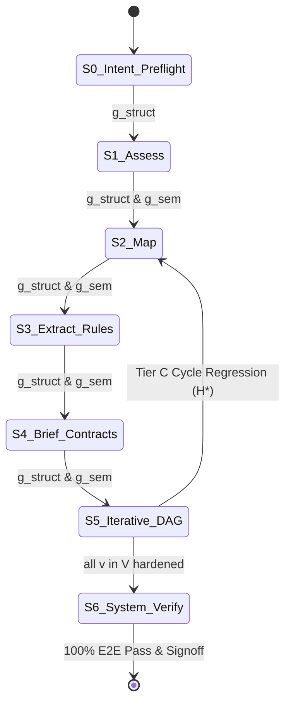
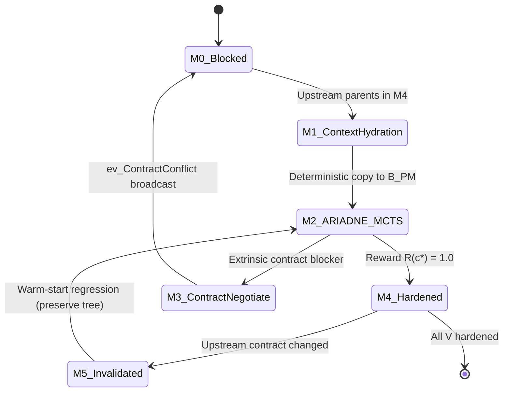

# Technical Specification: werðan Code Modernization Multi-Agent Architecture

## 1. Executive Summary & Architectural Authority

This technical specification establishes the formal architecture, module contracts, interfaces, data layouts, and system invariants for `werðan`.

### Authoritative Reference
Per **ADR 0005** (`docs/decisions/0005-methodology-source-of-truth.md`) and the root project policy, the inviolable mathematical and architectural ground truth of this system is:

> **[`docs/references/METHODOLOGY.md`](../references/METHODOLOGY.md)**

All module implementations, agent definitions, statechart lifecycles, and verification protocols derive from and are governed by `METHODOLOGY.md`. In case of any conflict between this document or historical notes and `METHODOLOGY.md`, `METHODOLOGY.md` strictly supersedes.

---

## 2. Workspace Crate Layout & Architectural Hierarchy

The codebase is organized as a strict hierarchical Cargo workspace rooted at `werðan/`, enforcing High Cohesion and Loose Coupling:

```text
werðan/
├── bins/                           # Execution Frontends
│   ├── interactive/                # Oh-My-Pi (OMP) Ratatui TUI cockpit (60/40 layout, CSI-2026)
│   └── daemon/                     # Headless batch CLI runner with dual-sink structured tracing
│
├── topology/                       # Orchestration & Multi-Agent Topology Layer
│   ├── operative/                  # Atomic agent blueprints, ReAct tool execution loops, stream emitters
│   ├── cluster/                    # Multi-operative ensembles & encapsulated ARIADNE MCTS search nodes
│   └── topology/                   # Turnkey runtime engine, Kahn's wave scheduler, event bus
│
└── infras/                         # Foundational Infrastructure & Domain Capabilities
    ├── core/                       # Shared protocol schemas, ModernizeConfig, PaneRole, wire events
    ├── blackboard/                 # Global Blackboard (G) and per-module 4-slice Local Blackboard (B)
    ├── statechart/                 # Deterministic Harel Statechart (S0..S6) and Micro-FSM (M0..M5)
    ├── laya/                       # Fast local System-1 model (guardrail, UCB action priors, JEV judge)
    └── tools/
        ├── mcp/                    # Filesystem sandbox, tree-sitter/LSP, compiler runner, test harness
        └── rea/                    # Reverse Engineering Assistant (binary CFG/DFG, ABI recovery)
```

---

## 3. Formal Data Layouts & Blackboard Schemas

The system operates across a two-tier blackboard architecture separating repository-wide state from module-scoped exploration.

### 3.1 Global Repository Blackboard ($\mathcal{G}$)

$$\mathcal{G} = \Big\langle \mathcal{I}_{\text{inv}}, \; G=(V,E), \; \mathcal{R}_{\text{rules}}, \; \mathcal{C}_{\text{contracts}}, \; \mathcal{A}_{\text{artifacts}}, \; \Sigma(\mathcal{G}) \Big\rangle$$

| Component | Type | Description |
| :--- | :--- | :--- |
| $\mathcal{I}_{\text{inv}}$ | `InventoryManifest` | File inventory, language/dialect profile, dependency manifests, build harness config. |
| $G = (V,E)$ | `CondensedDAG` | Condensed Dependency Directed Acyclic Graph where vertices $v_i \in V$ represent atomic translation units (or collapsed SCCs) and edges $e_{pi} = (v_p, v_i) \in E$ represent dependency obligations. |
| $\mathcal{R}_{\text{rules}}$ | $V \to 2^{\text{RuleCard}}$ | Verified `Given/When/Then` business rule cards with exact `legacy_file:line` source citations. |
| $\mathcal{C}_{\text{contracts}}$ | $E \to \text{InterfaceSpec}$ | Target-language type signatures, API contracts, and behavioral preconditions across dependency edges. |
| $\mathcal{A}_{\text{artifacts}}$ | $V \to (\text{TargetAST} \times \text{TestSuite})$ | Final hardened target modules and their passing characterization test suites. |
| $\Sigma(\mathcal{G})$ | `GlobalStateVector` | Transactionally persisted runtime state: $\langle S_{\text{macro}}, \mathbf{M}, \Theta_{H^*}, \mathcal{Q}_{\text{events}} \rangle$. |

### 3.2 Per-Module 4-Slice Local Blackboard ($\mathcal{B}^{(v_i)}$)

Each active module vertex $v_i \in V$ owns an isolated 4-slice local blackboard:

$$\mathcal{B}^{(v_i)} = \Big( \mathcal{B}_{PM}^{(v_i)}, \; \mathcal{B}_{SH}^{(v_i)}, \; \mathcal{B}_{CT}^{(v_i)}, \; \mathcal{B}_{PR}^{(v_i)} \Big)$$

1. **Problem Model ($\mathcal{B}_{PM}^{(v_i)}$)**: Hydrated deterministically from $\mathcal{G}$ upon activation. Contains legacy AST slices, extracted business rules $\mathcal{R}_{\text{rules}}(v_i)$, parent contracts $\{\mathcal{C}_{\text{contracts}}(v_p, v_i)\}$, and downstream export obligations.
2. **Strategy Hypotheses ($\mathcal{B}_{SH}^{(v_i)}$)**: Competing refactoring strategies $h_k$ (e.g., direct structural port vs. state-pattern decomposition) with prior utility estimates $P_{\text{prior}}$ from Laya.
3. **Counterexamples & Characterization Tests ($\mathcal{B}_{CT}^{(v_i)}$)**: Black-box I/O fixtures, property-based tests, and falsifying test inputs derived from legacy behavior.
4. **Patch & Fault Records ($\mathcal{B}_{PR}^{(v_i)}$)**: Distilled compiler diagnostics, test failure traces, and root-cause fault localizations indexing failed rollouts.

### 3.3 Dynamic Context Hydration (`TaskActivationEnvelope`)

Stateless worker agents receive push-based hydration envelopes generated deterministically:

$$\text{Hydrate}\big(\text{AgentRole}, \; \mu_{\text{mode}}, \; \text{target\_ref}, \; \mathcal{G}\big) \longrightarrow \mathcal{E}_{\text{act}} = \Big\langle \mu_{\text{mode}}, \; \mathcal{G}_{\text{slice}}, \; \Delta_{\text{directive}}, \; \mathcal{T}_{\text{tools}} \Big\rangle$$

where $\mu_{\text{mode}} \in \{\texttt{INITIAL}, \texttt{CRITIC\_RETRY}, \texttt{WARM\_START\_REGRESSION}\}$, $\mathcal{G}_{\text{slice}}$ bounds visibility to the 1-hop dependency subgraph, $\Delta_{\text{directive}}$ injects failure critiques or contract conflict traces, and $\mathcal{T}_{\text{tools}}$ binds deterministic AST/LSP navigation tools.

---

## 4. Statechart Execution Models & Control Topology

### 4.1 Tier 1: 7-Phase Macro-Statechart ($S_0 \dots S_6$)

The top-level orchestrator $\mathcal{O}_{\text{engine}}$ enforces seven sequential XOR Macro-States:



| Phase | Scatter ($S_m.1$) | Map ($S_m.2$, Parallel Workers) | Reduce ($S_m.3$) | Structural Guard ($g_{\text{struct}}$) | Semantic Guard ($g_{\text{sem}}$) |
| :--- | :--- | :--- | :--- | :--- | :--- |
| **$S_0$ Intent & Preflight** | None (atomic) | `PreflightProbe` | Direct | Legacy compiles; baseline test runs; valid `INTENT` schema | N/A (Empirical execution gate) |
| **$S_1$ Assess** | Directory shards | `ShardAssessor` (dialect, tech-debt) | `AssessmentSynthesizer` | 100% file coverage vs. `scc`/`cloc`; valid metric ranges | `AssessmentCritic`: verifies file citations, flags unmapped dialects |
| **$S_2$ Map (DAG)** | Static AST/LSP graph builder | `ImplicitCouplingScanner` (reflection, dynamic calls) | Tarjan's SCC condensation $\to G=(V,E)$ | $G=(V,E)$ strictly acyclic; each file in exactly one $v_i$ | `TopologyCritic`: audits shared tables, event buses, dynamic links |
| **$S_3$ Extract Rules** | Vertex batches from $V$ | `RuleMiner` (`Given/When/Then` cards) | `CrossModuleRuleLinker` | Every card has valid syntax, `legacy/file:line`, observed tags | `RuleAuditor`: independent audit against legacy AST for hallucination |
| **$S_4$ Brief & Contracts** | Global idioms by `MacroArchitect` | `ContractStubber` (interface stubs) | Target compiler stub compatibility | All edges $e_{pi} \in E$ have compilable target stubs | `ArchitectureCritic`: audits stubs against $\mathcal{R}_{\text{rules}}$ for over-engineering |
| **$S_5$ Iterative DAG** | Kahn's wave scheduler | Parallel ARIADNE clusters over $\text{ReadySet}(\mathcal{G})$ | Artifact & test commitment | $\forall v_i \in V, M(v_i) = \texttt{M4\_Hardened}$ ($R(c^\star) = 1.0$) | Intra-cluster $\mathcal{A}_{\text{eval}}^{\text{distill}}$ rule parity verification |
| **$S_6$ System Verify** | E2E test suites & SAST | `IntegrationVerifier` & `SecurityAuditor` | Release signoff generator | 100% E2E pass rate; 0 critical SAST/CVE vulnerabilities | `ReleaseAuditor`: final compliance signoff against `INTENT` |

#### Declarative Scatter-Gather Invariant ($D_{\max} = 1$)
Non-ARIADNE agents are strictly prohibited from imperative subagent spawning. Parallel macro-phases execute a deterministic 3-stage sub-statechart:
1. **$S_m.1$ Scatter**: Deterministically partitions workload into $K$ bounded shards satisfying token limit $L_{\max}$.
2. **$S_m.2$ Parallel Map**: $\mathcal{O}_{\text{engine}}$ spawns $K$ parallel, stateless workers $W_1 \dots W_K$. Cross-file links emit declarative `UnresolvedCrossLink(src, symbol)` tags.
3. **$S_m.3$ Reduce**: Linker agent or graph reducer synthesizes cross-shard linkages.

#### Two-Stage Hybrid Guards ($g = g_{\text{struct}} \land g_{\text{sem}}$)
Phase exit requires a short-circuiting conjunction:
1. **Stage 1 ($g_{\text{struct}}$)**: Zero-token programmatic check (AST parsing, schema validation, DAG acyclicity). Shard failures trigger immediate retry of failed shards with validator traces.
2. **Stage 2 ($g_{\text{sem}}$)**: Sharded, read-isolated adversarial LLM critic (`ShardCritic`) auditing produced artifacts against legacy source citations.

---

### 4.2 Tier 2: Module Micro-FSM ($M_0 \dots M_5$) & Wave Scheduler

In state $S_5$, each module vertex $v_i \in V$ executes an orthogonal region $R(v_i)$:



- **`M0_Blocked`**: Waiting for all upstream parent modules $\{v_p \mid (v_p, v_i) \in E\}$ to achieve `M4_Hardened`.
- **`M1_ContextHydration`**: Deterministic (non-LLM) copying of $\mathcal{R}_{\text{rules}}(v_i)$ and parent contracts $\{\mathcal{C}_{\text{contracts}}(v_p, v_i)\}$ from $\mathcal{G}$ into $\mathcal{B}_{PM}^{(v_i)}$.
- **`M2_ARIADNE_MCTS`**: Active intra-module MCTS synthesis and verification loop.
- **`M3_ContractNegotiate`**: Emits `ev_ContractConflict(v_p, v_i, \Delta_{\text{spec}}, \text{trace})` to event bus $\mathcal{Q}_{\text{events}}$ and returns $v_i$ to `M0_Blocked`.
- **`M4_Hardened`**: Candidate achieves $R(c^\star) = 1.0$; commits code and characterization tests $\mathcal{B}_{CT}^{(v_i)}$ to $\mathcal{A}_{\text{artifacts}}(v_i)$; emits `ev_ModuleHardened(v_i)`.
- **`M5_Invalidated`**: Triggered by validated contract modifications from upstream parents. Appends $\Delta_{\text{spec}}$ to $\mathcal{B}_{PM}^{(v_i)}$ while **preserving** existing search tree $\mathcal{T}^{(v_i)}$, strategies $\mathcal{B}_{SH}^{(v_i)}$, and test suite $\mathcal{B}_{CT}^{(v_i)}$ for rapid warm-start repair.

#### Topological Wave Dispatch (Kahn's Algorithm)
At each scheduling step in $S_5$, the engine recomputes:

$$\text{ReadySet}(\mathcal{G}) = \Big\{ v_i \in V \;\Big\vert{}\; M(v_i) = \texttt{M0\_Blocked} \;\land\; \forall (v_p, v_i) \in E, \; M(v_p) = \texttt{M4\_Hardened} \Big\}$$

All vertices in $\text{ReadySet}(\mathcal{G})$ are dispatched concurrently up to concurrency cap $K_{\max}$.

---

## 5. Encapsulated ARIADNE Intra-Module MCTS Solver (`M2`)

### 5.1 Deterministic MCTS Controller ($\mathcal{C}_{\text{MCTS}}^{(v_i)}$)
Maintains module search tree $\mathcal{T}^{(v_i)}$ where nodes represent states $u = (c_t, \mathcal{B}_t^{(v_i)})$. Traversal samples children via temperature-controlled Softmax-UCB:

$$\text{UCB}(u) = \bar{R}(u) + C_{\text{exp}} \sqrt{\frac{\ln(N(v) + 1)}{N(u)}} + \gamma \cdot P_{\text{prior}}(u)$$

$$p(u \mid v) = \frac{\exp\big((\text{UCB}(u) - \max_{w} \text{UCB}(w)) / \tau\big)}{\sum_{w \in \text{Children}(v)} \exp\big((\text{UCB}(w) - \max_{w'} \text{UCB}(w')) / \tau\big)}$$

Default constants: $C_{\text{exp}} = 1.414$, $\tau = 0.35$, $\gamma = 0.15$.

### 5.2 Ephemeral Generative Subagents (Strict Read/Write Isolation)
- **$\mathcal{A}_{\text{str}}$ (Strategy Analysis)**: Reads $\mathcal{B}_{PM}^{(v_i)}$; writes distinct refactoring hypotheses $\{h_1 \dots h_{K_s}\}$ with prior utility scores to $\mathcal{B}_{SH}^{(v_i)}$.
- **$\mathcal{A}_{\text{gen}}$ (Code Generation)**: Reads $\mathcal{B}_{PM}^{(v_i)}$ and selected hypothesis $h$; generates candidate target code $c'$.
- **$\mathcal{A}_{\text{test}}$ (Adversarial Test Generation)**: Reads $\mathcal{B}_{PM}^{(v_i)}$ and legacy reference behavior. **Strictly read-isolated from candidate code $c'$** to prevent test weakening or cheat fitting. Generates property tests and characterization snapshots into $\mathcal{B}_{CT}^{(v_i)}$.
- **$\mathcal{A}_{\text{patch}}$ (Surgical Code Repair)**: Reads failing candidate $c_t$ and localized fault card in $\mathcal{B}_{PR}^{(v_i)}$; emits minimal diff patch $c''$.

### 5.3 Two-Stage Hybrid Evaluator ($\mathcal{A}_{\text{eval}} = \mathcal{A}_{\text{eval}}^{\text{exec}} \circ \mathcal{A}_{\text{eval}}^{\text{distill}}$)
- **Stage 3a — Deterministic Execution Harness ($\mathcal{A}_{\text{eval}}^{\text{exec}}$)**: Compiles $c'$ against parent artifacts, runs type checking, executes test suite $\mathcal{B}_{CT}^{(v_i)}$, and runs security scanners.
- **Stage 3b — Diagnostic Distiller & Parity Critic ($\mathcal{A}_{\text{eval}}^{\text{distill}}$)**:
  - *On Failure*: Distills raw compiler/test stack traces into a localized fault record in $\mathcal{B}_{PR}^{(v_i)}$ and classifies fault cause $\kappa \in \{\texttt{INTRINSIC}, \texttt{EXTRINSIC\_CONTRACT}, \texttt{EXTRINSIC\_CYCLE}\}$.
  - *On Pass*: Audits $c'$ against all `Given/When/Then` rule cards in $\mathcal{B}_{PM}^{(v_i)}$ to compute semantic parity score $\text{Score}_{\text{harden}}(c') \in [0, 1]$.

### 5.4 Gated Hierarchical Reward Function $R(s_t)$

$$R(s_t) = w_{\text{comp}} \cdot \mathbb{I}_{\text{compile}}(c_t) + \mathbb{I}_{\text{compile}}(c_t) \cdot \Big[ w_{\text{char}} \cdot \text{PassRate}_{\text{char}}\big(c_t, \mathcal{B}_{CT}^{(v_i)}\big) + w_{\text{hard}} \cdot \text{Score}_{\text{harden}}\big(c_t, \mathcal{B}_{PM}^{(v_i)}\big) \Big]$$

Default weights: $w_{\text{comp}} = 0.20$, $w_{\text{char}} = 0.60$, $w_{\text{hard}} = 0.20$ ($w_{\text{comp}} + w_{\text{char}} + w_{\text{hard}} = 1.0$).
Uncompilable code strictly receives $R(s_t) = 0.0$. Achieving $R(s_t) = 1.0$ is the necessary and sufficient condition for module hardening.

---

## 6. Multi-Tier Regression Calculus

| Tier | Fault Class ($\kappa$) | Scope & Traffic | Action & Recovery Mechanism |
| :--- | :--- | :--- | :--- |
| **Tier A** | `INTRINSIC` | Intra-module only (Zero global traffic) | Backpropagates $R(s_t) < 1.0$ up tree $\mathcal{T}^{(v_i)}$; dispatches $\mathcal{A}_{\text{patch}}$ using fault record $\mathcal{B}_{PR}^{(v_i)}$ or explores alternate hypothesis in $\mathcal{B}_{SH}^{(v_i)}$. |
| **Tier B** | `EXTRINSIC_CONTRACT` | Cross-module 1-hop via broadcast event bus | Downstream $v_i$ transitions to `M3` and emits `ev_ContractConflict`. Engine validates conflict via arbiter, updates contract $\mathcal{C}_{\text{contracts}}(v_p, v_i)$, parks $v_i \to \texttt{M0}$, and transitions parent $v_p \to \texttt{M5\_Invalidated} \to \texttt{M2}$ with warm-started tree. |
| **Tier C** | `EXTRINSIC_CYCLE` | Repository-wide macro-regression with Deep History ($H^*$) | Emits `ev_CyclicDependencyFound`. Engine checkpoints active module state vector $\Theta_{H^*}(S_5) \leftarrow \mathbf{M}$, transitions $S_5 \to S_2$, condenses cyclic vertices via Tarjan's SCC into $v_{\text{SCC}}$, updates rules ($S_3$) and stubs ($S_4$), and re-enters $S_5$ via $H^*$, restoring unaffected modules without re-execution. |

---

## 7. Migration Configuration Specification (`ModernizeConfig`)

The canonical configuration schema defined in `werðan/infras/core/src/lib.rs` and accepted by frontends:

```yaml
campaign_id: "modernize-campaign-001"
execution_mode: "hitl"                        # "hitl" | "full_auto"

paths:
  input_legacy_dir: "./legacy-source"
  workspace_root: "./modernized-target"
  off_limits_globs:
    - "**/.git/**"
    - "**/target/**"

stack:
  source_language: "cpp14"
  binary_artifacts: []
  use_ghidra_rea: true
  target_language: "rust"
  target_edition_or_framework: "2024"
  target_build_cmd: "cargo check"
  target_test_cmd: "cargo test"
  legacy_test_harness_cmd: "ctest"

inference:
  ninfer_base_url: "http://localhost:8000/v1"
  deep_model: "ashalliant/qwen3.8-27b-abliterated"
  fast_model: "ashalliant/qwen3.8-27b-abliterated"
  max_parallel_shards: 2
  user_input_mode: "wait"                     # "wait" | "immediate"
  max_shards: 2
  base_url: "http://localhost:8000/v1"
  model: "ashalliant/qwen3.8-27b-abliterated"
  inference_max_tokens: 32768
  inference_temperature: 0.2
  inference_timeout_secs: 600
  build_timeout_secs: 120
  test_timeout_secs: 120

verification:
  max_self_heal_retries: 3
  require_byte_identical_io: false

hitl:
  gate_on_reimagine: true                     # Human signoff required after S4 before S5
  gate_on_macro_regression: true              # Human signoff required before rolling S5 -> S2
  extrinsic_conflict_escalation: "auto_negotiate" # "auto_negotiate" | "ask_human"

ariadne:
  mcts_budget_per_module: 24                 # Maximum rollouts (B_max) in state M2
  ucb_exploration_c: 1.414                    # Exploration constant for Softmax-UCB
  softmax_temperature: 0.35                  # Softmax temperature for prior sampling
  reward_weights:
    compile: 0.20                             # w_comp weight for clean compilation
    characterization_parity: 0.60             # w_char weight for equivalence test pass rate
    hardening_score: 0.20                     # w_hard weight for semantic rule adherence
```

---

## 8. Known In-Tree Code Divergence & Reconciliation Roadmap

Per ADR 0005, the following in-tree Rust discrepancies exist relative to the authoritative model in `METHODOLOGY.md`:

1. **Macro State Machine**:
   - *Authoritative Model*: 7-phase Harel Statechart ($S_0 \dots S_6$).
   - *In-Tree Code (`werðan/infras/statechart`)*:
     - `MacroState`: 5 states (`S1Assess`, `S2Map`, `S3Reimagine`, `S4DagTransform`, `S5VerifyRelease`).
     - `ModernizationState`: 10 states (`S0Intent` .. `S9Completed`).
2. **Reconciliation Target**:
   - Refactor `werðan/infras/statechart` and `werðan/topology` to represent the canonical 7-phase `MacroState` ($S_0 \dots S_6$) and 6-state `MicroState` ($M_0 \dots M_5$) directly.
   - Deprecate flat `ModernizationState` in favor of hierarchical Harel state representation with orthogonal regions.
